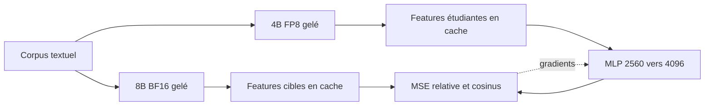

# Alignement initial des encodeurs

Lecture guidée : [notebook 02 — Encodeurs et MSE](../notebooks/02_encodeurs_et_mse.ipynb).

Cette étape prépare les modèles, contrôle le chargement FP8 et entraîne le projecteur initial. Le 8B d'origine de Qwen-Image-2.1 fournit les cibles ; le 4B FP8 reste gelé. Le projecteur MLP reçoit seul des gradients.

Les états précèdent la RMSNorm finale et conservent le template, l'ordre et les tokens attendus par le diffuseur. `cache_features.py --cache-root ... --corpus ...` permet de créer un cache indépendant pour un nouveau corpus. Les identités de modèles et l'empreinte du corpus empêchent la réutilisation silencieuse de features incompatibles.

`train_projector.py` effectue 1 000 pas linéaires puis 5 000 pas MLP par défaut. Il optimise `MSE relative + 0.1 × (1 − cosinus)`. La MSE relative divise la moyenne des carrés des différences par la moyenne des carrés de la cible ; l'évaluation moyenne ensuite les scores des prompts. Le checkpoint est choisi selon la MSE des embeddings.

`validate_base.py` compare aussi quelques prédictions de flow et des générations appariées. Les seuils numériques sont des contrôles de fonctionnement. Ils ne démontrent pas le respect général des positions. La nouvelle expérience [03-spatial-distillation](../03-spatial-distillation/README.md) ajoute attention entre tokens, contrôle par boîtes, apprentissage supervisé sur des images et évaluation spatiale.

Les sorties historiques restent dans `artifacts/projector` et `cache/{teacher,student}`. La nouvelle expérience utilise ses propres dossiers. La compatibilité de lecture des anciens projecteurs est conservée dans la classe partagée `Projector`.
