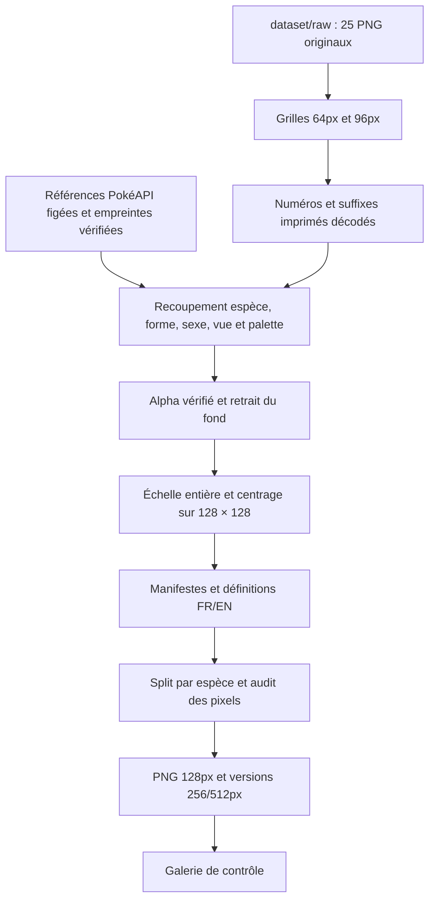

# Sharm Image Monster Pixel Art

Lecture guidée : [notebook 01 — Dataset](../notebooks/01_dataset_monster.ipynb), puis [notebook 05 — LoRA Monster](../notebooks/05_lora_monster.ipynb).

Spécialisation de **Sharm Image Base** pour produire des monstres en pixel art, en **PNG RGBA 128 × 128**. Sharm Image Base contient le générateur Qwen Image 2.1 et son encodeur Qwen3-VL 4B FP8 intégré. Le LoRA apprend le style du diffuseur avec un projecteur validé et figé.

## Dataset actuel

La préparation complète des nouvelles données est décrite dans [dataset/README.md](dataset/README.md).

| Élément | Quantité |
|---|---:|
| PNG fournis | 25 |
| Planches distinctes | 24 |
| Cellules découpées | 4 508 |
| Images RGBA uniques | 4 481 |
| Espèces présentes | 649 |
| Entraînement / validation | 4 084 / 397 images |

Les 27 doublons de cellules sont regroupés avec leurs provenances et variantes équivalentes. `48088 (1).png` est un doublon exact de `48088.png` ; les deux originaux sont conservés.



Les deux styles sont explicitement légendés : **Emerald** et **Black/White**. Les vues de face/dos, formes, sexes visibles et palettes normales/shiny sont distingués. Les anciennes planches de 64px sont des **sprites de combat et leurs poses d'animation** ; le terme historique « overworld » était incorrect.

## Préparer et contrôler

Depuis la racine du dépôt, avec Python, Pillow et NumPy :

```powershell
.\.venv-spatial-check\Scripts\python.exe 2-LoRA-qwen/02-sprite-lora/fetch_monster_references.py
.\.venv-spatial-check\Scripts\python.exe 2-LoRA-qwen/02-sprite-lora/prepare_monster_dataset.py
.\.venv-spatial-check\Scripts\python.exe 2-LoRA-qwen/02-sprite-lora/audit_monster_dataset.py 2-LoRA-qwen/02-sprite-lora/dataset/prepared/monster-clean-v2
```

Une préparation terminée n'est pas écrasée : `--output-dir` crée une nouvelle version. L'entrée historique `prepare_dataset.py` reste disponible pour reproduire l'ancien dataset à six planches sous `2-LoRA-qwen/dataset/`.

## Utilisation par le LoRA

Le dataset contient `train_256/metadata.jsonl`, `train_512/metadata.jsonl`, `caption-corpus.jsonl` et `manifest.csv`. Les PNG de travail sont des agrandissements entiers des cibles 128px. Tous les exemples d'une espèce restent ensemble : normal/shiny, face/dos, formes et poses ne traversent pas les splits.

`prepare_training_cache.py` accepte `--dataset-root`, `--cache-root`, `--projector-dir`, `--base-validation` et `--output-report`. Cela prépare des caches dédiés au nouveau corpus et liés au SHA-256 du projecteur. Les features texte manquantes doivent d'abord être calculées avec `01-encoder-distillation/cache_features.py student --corpus .../caption-corpus.jsonl --cache-root ...`.

`train_lora.py` accepte `--training-cache` et `--base-validation`. Le contrôle de compatibilité reste obligatoire ; après un changement de projecteur, il faut recalculer les embeddings et entraîner un LoRA compatible.

**Cette mise à jour prépare les données ; elle ne lance pas un nouvel entraînement Monster et ne publie pas de nouveaux poids.** La chaîne spatiale de Sharm Image Base utilise son dataset et ses caches existants sur le serveur SSH.

## Anciens résultats

Les poids déjà publiés dans `Sharm-Image-2.1-Sprites-128-LoRA` ont été entraînés sur un corpus antérieur, avec l'ancien projecteur. Les nombres et définitions de cette préparation ne décrivent pas cet entraînement historique. Sa compatibilité avec une nouvelle révision de Sharm Image Base devra être établie séparément.
