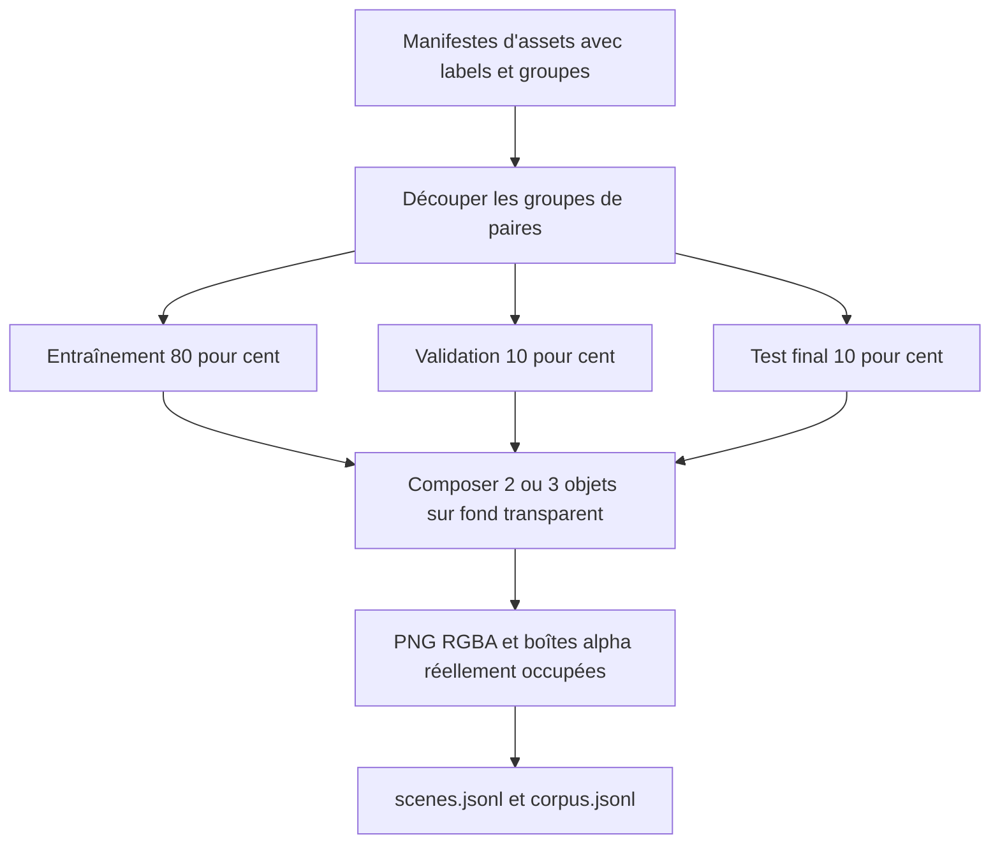
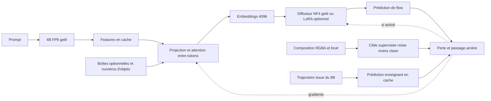
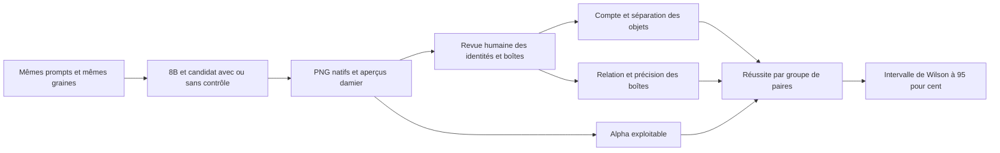

# Apprentissage des positions avec le 4B FP8

La reprise sur le serveur SSH de 16 Go est décrite dans [REMOTE.md](REMOTE.md), avec le transfert vérifié, le budget disque et les étapes de publication.

Cette expérience vise le respect de la position, de la séparation et du nombre des objets, avec une sortie PNG RGBA. Les poids du Qwen 4B FP8 restent gelés. On entraîne d'abord un projecteur contextuel, puis ce projecteur avec un objectif lié aux images. Un LoRA du diffuseur peut être ajouté dans une expérience distincte.

**Statut : code préparé, candidat à entraîner et à évaluer.** Les tests CPU couvrent la géométrie, les gradients d'un modèle réduit, la compatibilité des projecteurs et le calcul des scores. Ils ne prouvent ni la compatibilité du backward NF4 sur GPU ni la qualité des générations. Aucun score de parité avec le 8B n'est annoncé.

## Données et positions de référence



`prepare_dataset.py` assemble les assets sans chevauchement, conserve leur ratio et mesure les boîtes visibles après placement. Il produit des consignes françaises et anglaises, les relations gauche/droite/dessus/dessous, deux ou trois objets et plusieurs tailles. Les descriptions associent explicitement les numéros des objets aux boîtes normalisées `xyxy`.

Une paire de groupes d'objets et toutes ses variantes restent dans le même split. Le test mesure donc de nouvelles **combinaisons d'assets connus**, pas la généralisation à toutes les images ou à des espèces inconnues. Les échelles et positions sont encore simples ; ajouter des layouts plus variés constitue une extension du corpus, pas une capacité déjà démontrée.

Pour utiliser les six planches existantes (1 540 sprites, 384 espèces ; palettes normales et shiny), commencer par leur [découpage corrigé](../02-sprite-lora/README.md). Les espèces absentes et les formes de Castform sont traitées explicitement. Toutes les variantes d'une espèce ont le même groupe pour la séparation des paires :

```bash
PY=./1-local-generation/.venv-qwen/bin/python
$PY 2-LoRA-qwen/prepare_dataset.py --training-size 256
$PY 2-LoRA-qwen/03-spatial-distillation/run.py --stage data \
  --sprites 2-LoRA-qwen/dataset/train_256/metadata.jsonl
```

Pour d'autres PNG, préparer un JSONL avec des chemins relatifs au manifeste :

```json
{"id":"bike-v1","group_id":"bike","label":"black bicycle","file_name":"bike.png"}
{"id":"boat-v1","group_id":"boat","label":"purple sailing boat","file_name":"boat.png"}
{"id":"flower-v1","group_id":"flower","label":"yellow flower","file_name":"flower.png"}
```

Au moins trois groupes sont requis. Pour une évaluation crédible sur des centaines de combinaisons, utiliser une bibliothèque beaucoup plus grande. Deux variantes d'une même espèce doivent partager `group_id`. Les prompts dépendent des labels : une mauvaise légende introduit une cible incorrecte.

Si les planches originales sont absentes, une source téléchargeable est disponible :

```bash
$PY 2-LoRA-qwen/03-spatial-distillation/run.py --stage data --pokeapi
```

`prepare_assets.py` récupère les 386 premières espèces et leurs variantes normale/shiny depuis [PokeAPI/sprites](https://github.com/PokeAPI/sprites), à une révision Git figée lors de la première préparation. Il enregistre les URLs, empreintes et légendes en cache. Ce sont des **sprites de combat de face**, différents des planches overworld originales ; la provenance est explicite et le dataset historique n'est pas remplacé. Le profil 8 Go utilise 3 600 compositions pour limiter le volume des features textuelles sur disque.

## Ce qui reçoit des gradients



1. **Warmup** : aligner les représentations avec MSE relative + `0.1 × (1 − cosinus)`. Les séquences restent complètes et dans l'ordre. Le projecteur initial peut être réutilisé ; les nouveaux blocs sont initialisés séparément.
2. **Flow supervisé** : encoder la composition RGBA avec le VAE, mélanger son latent avec du bruit, apprendre la cible `noise − clean`. La supervision des positions vient ici des images réellement composées.
3. **Distillation** : reproduire les prédictions du diffuseur original sur des latents issus de vraies trajectoires Euler conditionnées par le 8B. Les points sont tirés dans toute la trajectoire, avec une graine propre à chaque scène. Les profils limitent ce cache coûteux à 512 scènes, avec une partie réservée à la validation ; seules les trajectoires du split train reçoivent des gradients. Toutes les compositions continuent de participer à la supervision par images. Ces cibles favorisent la conservation du comportement du modèle de référence ; elles peuvent aussi reproduire ses défauts.

La perte flow par défaut vaut `MSE supervisée + 0.25 × MSE relative de distillation + 0.05 × perte d'embeddings`. Les deux gros passages arrière sont effectués séparément pour libérer leurs activations. Ces coefficients sont des points de départ expérimentaux. La moitié des exemples utilise un prompt naturel sans coordonnées ni tokens de boîtes ; l'autre moitié ajoute les coordonnées textuelles et les tokens de contrôle. Les deux variantes ont des features mises en cache séparément. Les trajectoires du 8B utilisent les prompts naturels.

Le projecteur possède deux petits blocs d'attention dans un espace de largeur 1024. Les boîtes ajoutent des tokens appris associés aux numéros d'objets. Cela fournit un contrôle entraînable ; **cela ne contraint pas mathématiquement les pixels générés à rester dans une boîte**.

## Lancement, mémoire et reprise

Le runtime GPU supporté est Linux/WSL avec les dépendances figées de `setup_sharm.sh`. Le chargement FP8 actuel sert à l'inférence ; les petits composants sont entraînés avec autocast BF16 et poids maîtres FP32. Le quantificateur officiel est déclaré [non entraînable dans ce backend](https://github.com/huggingface/transformers/blob/v5.20.1/src/transformers/quantizers/quantizer_finegrained_fp8.py).

Triton compile ses kernels au premier calcul : un compilateur C (`build-essential` sous Ubuntu) est requis, en plus de CUDA et des paquets Python. Le bootstrap Windows installe ce prérequis si nécessaire ; sous Linux, l'installer avant le setup. Le contrôle `run.py --check` vérifie aussi sa présence et celle de `torchvision`.

```bash
# Installer le runtime et télécharger les modèles si absents.
./2-LoRA-qwen/setup_sharm.sh
PY=./1-local-generation/.venv-qwen/bin/python
$PY 2-LoRA-qwen/01-encoder-distillation/prepare_models.py

# Contrôler présence des dépendances, CUDA et fichiers de modèles.
$PY 2-LoRA-qwen/03-spatial-distillation/run.py --check

# Vérifier le vrai gradient NF4 -> projecteur avant un entraînement long.
HF_HUB_OFFLINE=1 $PY 2-LoRA-qwen/03-spatial-distillation/verify_runtime.py --resolution 256 --tokens 224

# Construire les caches, entraîner et produire une première galerie de validation.
HF_HUB_OFFLINE=1 $PY 2-LoRA-qwen/03-spatial-distillation/run.py \
  --sprites 2-LoRA-qwen/dataset/train_256/metadata.jsonl \
  --profile 2-LoRA-qwen/03-spatial-distillation/configs/8gb.json
```

Les profils sont des propositions, pas des mesures de VRAM : `8gb.json` utilise 256 px et le checkpointing intégral ; `16gb.json` utilise 512 px et le checkpointing alterné. Ils commencent sans LoRA. Si les résultats plafonnent, copier le profil, choisir un nouveau `--output`, et régler `flow.lora-rank` à 8 ou 16. Comparer les résultats avant de retenir ce supplément de capacité.

Le 8B, le 4B et le VAE sont employés dans des processus séparés. Leurs features et les cibles sont mises en cache, puis ces modèles sont libérés avant le backward du diffuseur. Le 8B répartit ses couches entre GPU et RAM à partir de la mémoire disponible, en réservant 2 Gio sur le GPU et 2 Gio de RAM. Les couches restantes sont déportées dans `cache/teacher-offload` si nécessaire ; cela consomme du disque et peut être lent sur cette petite machine. Le cache de trajectoires stocke un latent et une prédiction par point ; à 512 px, trois points représentent environ 0,75 Mio par scène hors index. Prévoir aussi les features textuelles et les PNG.

Chaque étape est accessible par `--stage data|features|latents|trajectories|warmup|flow|generation`. Les étapes d'entraînement enregistrent optimiseur, poids, RNG CPU/CUDA/Python et progression. Un changement de configuration, de dataset, de code ou de poids source exige un nouveau dossier d'expérience. La sélection numérique et l'arrêt anticipé utilisent seulement le split validation. Le split test n'intervient pas dans les pertes ni dans la sélection.

Pour les longues exécutions, utiliser un terminal persistant comme `tmux`. Le runner reste au premier plan, transmet les interruptions à son processus courant et ne lance aucun upload.

Sous Windows, `start_local.ps1` orchestre le setup WSL, les téléchargements puis la chaîne. Il enregistre sa progression dans `artifacts/spatial/bootstrap-status.json`. Par exemple, le lancer dans un PowerShell persistant avec `./2-LoRA-qwen/03-spatial-distillation/start_local.ps1 -Pokeapi`. Les options `-WaitSetupPid`, `-WaitDownloadPid` et `-WaitForDataset` permettent de reprendre une préparation déjà engagée sans démarrer des téléchargements concurrents. Pour le détacher, utiliser `Start-Process` avec `-WindowStyle Hidden` et rediriger ses journaux.

Le setup télécharge et vérifie aussi le kernel FP8 officiel, avec son snapshot complet `v4` en cache. Après préparation des modèles, le bootstrap exécute le calcul avec `HF_HUB_OFFLINE=1` pour éviter les accès réseau pendant les extractions. `-UsePreparedRuntime` réutilise un runtime, des kernels et des poids déjà préparés ; les contrôles de prérequis et les audits GPU du runner restent actifs.

## Mesurer le résultat spatial



La première galerie de 24 prompts est une inspection, pas une preuve statistique. Une fois les hyperparamètres arrêtés, générer le **test final** avec plusieurs graines, par exemple :

```bash
$PY 2-LoRA-qwen/03-spatial-distillation/generate.py \
  --candidate 2-LoRA-qwen/artifacts/spatial/run/flow/best \
  --output 2-LoRA-qwen/artifacts/spatial/test-final \
  --split test --limit 600 --include-teacher
$PY 2-LoRA-qwen/03-spatial-distillation/review.py \
  --predictions 2-LoRA-qwen/artifacts/spatial/test-final/predictions.json
```

Ouvrir `review.html`, tracer les boîtes réelles, confirmer l'identité de chaque objet, signaler les fusions/extras et exporter `annotations.json`. Le numéro de méthode est masqué. Il faut une revue explicite par image ; aucun détecteur automatique n'est supposé reconnaître correctement les espèces. Pour limiter la subjectivité, une seconde revue indépendante et son accord avec la première restent recommandés.

```bash
$PY 2-LoRA-qwen/03-spatial-distillation/evaluate.py \
  --predictions 2-LoRA-qwen/artifacts/spatial/test-final/predictions.json \
  --annotations 2-LoRA-qwen/artifacts/spatial/test-final/annotations.json \
  --methods candidate_text candidate_layout teacher_text teacher_layout \
  --output 2-LoRA-qwen/artifacts/spatial/test-final/spatial-report.json
```

Une image réussit si tous les objets attendus sont identifiés, distincts, sans objet supplémentaire, si la relation est respectée sans chevauchement entre boîtes, et si l'alpha contient des pixels visibles et transparents. Pour les méthodes `*_layout`, chaque boîte doit aussi avoir `IoU >= 0.5` et l'erreur maximale de centre doit être `<= 0.05` de la taille de l'image. Les métriques de boîte sont enregistrées dans tous les modes, mais le prompt naturel ne fixe aucun centre exact. Une revue manquante échoue. Les empreintes lient les annotations aux images exactes.

Comparer `candidate_text` à `teacher_text` pour le même prompt naturel, et `candidate_layout` à `teacher_layout` pour le même prompt avec coordonnées. Seul le candidat layout reçoit aussi les tokens de boîtes appris. Les graines et le runtime sont partagés. Le rapport distingue explicitement le respect des relations et celui des positions chiffrées.

Un groupe de paires réussit seulement si **toutes ses scènes et graines** réussissent. L'intervalle de Wilson utilise ces groupes, et non les images corrélées d'un même prompt. Le filtre proposé exige 300 groupes et une borne basse à 95 % supérieure ou égale à 95 %. Les hypothèses statistiques et le vocabulaire d'assets limitent la portée du résultat. Les seuils sont une politique explicite, pas une preuve de perfection ni une métrique universelle.

## Utiliser un candidat

```bash
$PY 2-LoRA-qwen/03-spatial-distillation/infer.py \
  --candidate 2-LoRA-qwen/artifacts/spatial/run/flow/best \
  --prompt 'Exactly two objects. Object 1 is to the left of object 2. Transparent background.' \
  --layout layout.json --output 1-local-generation/outputs/spatial.png
```

`layout.json` contient `objects: [{"label":"Bulbasaur","box":[0.1,0.25,0.4,0.75]}, ...]`. L'ordre des objets doit correspondre au prompt. `infer.py` utilise le 4B FP8 réel et le nouveau projecteur. Le loader partagé accepte aussi les exports `spatial-v1` avec un paramètre `layout` ; voir [la publication et ses vérifications](../publish/README.md).

Pour **placer des PNG existants exactement**, `compose_layout.py` applique directement les allocations, conserve le ratio et refuse les chevauchements. Son JSON contient aussi `resolution` et `file_name` pour chaque asset, relatif au JSON. Il enregistre les boîtes effectivement peintes. Cette composition déterministe n'est pas une génération libre.

## Vérifications du code

```bash
python -m unittest discover -s 2-LoRA-qwen/tests -p 'test*.py' -v
```

Les 35 tests couvrent les cellules des six planches, les espèces absentes, les formes et légendes shiny, le retrait du fond y compris ses îlots fermés, l'export PNG avec conservation exacte de l'alpha, les aperçus damier séparés, le rejet des rendus opaques ou vides, les compositions, les splits, les scores et les projecteurs. Ils exécutent aussi un vrai warmup CPU sur des features synthétiques, sauvegardent/rechargent son checkpoint et refusent une reprise avec une configuration différente. Les contrôles de publication vérifient le contrat du layout, sa concordance exacte avec le corpus local, le chargement séquentiel, les empreintes, la revue complète et le périmètre des fichiers autorisés. Ils ne publient rien et ne remplacent pas la vérification GPU finale de l'export. `train.py warmup --device cpu` est utilisable avec des caches existants sans GPU ; ce mode n'effectue aucun encodage FP8.

Pour contrôler les vrais kernels sur GPU, exécuter successivement, sans autre entraînement simultané :

```bash
$PY 2-LoRA-qwen/01-encoder-distillation/audit_runtime.py
$PY 2-LoRA-qwen/03-spatial-distillation/verify_runtime.py --resolution 256 --tokens 224
```

Le premier contrôle vérifie l'alignement des tokenizers, le maintien des poids textuels FP8 sur CUDA et la cohérence de l'encodage. Le second réalise deux pas de gradients avec le vrai diffuseur NF4 gelé, un projecteur contextuel et des boîtes, avec AdamW8bit. Il écrit `artifacts/spatial/runtime-backward-audit.json`, avec les pertes et le pic mémoire. Les 224 tokens couvrent le maximum mesuré du corpus local actuel avec une marge ; un autre corpus peut exiger davantage. Ces contrôles prouvent le fonctionnement du calcul, pas la qualité spatiale d'un modèle entraîné. La publication actuellement demandée sur le dépôt HF de la base intervient après la chaîne complète, la revue et la vérification du loader exporté ; elle est décrite dans [le protocole de publication](../publish/README.md).
