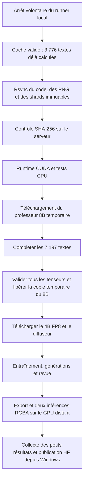

# Reprendre sur la machine SSH de 16 Go

La reprise conserve les 3 600 compositions à 256 px et les pas du profil 8 Go. `configs/remote16gb-256.json` change uniquement le checkpointing du diffuseur en `alternating`, afin de profiter des 16 Go sans reconstruire le corpus ni perdre le cache du professeur.

## Lancement isolé

Le workspace utilisé pour cette migration est `/home/eth/sharm-spatial-20261019`. Il est privé et ne remplace pas un projet existant. La connexion SSH est multiplexée, avec keepalive, sans enregistrer de mot de passe dans les scripts. Le processus d'entraînement est détaché de SSH et possède ses verrous de concurrence.

`start_remote.sh` prépare Python 3.12, installe le runtime épinglé, vérifie les dépendances et lance les tests. Il appelle ensuite `run_remote.py`, qui gère le budget disque et reprend les caches compatibles. Le binaire `tools/uv` doit être disponible avant le premier lancement.

Le marqueur privé `artifacts/spatial/remote-workspace.json` doit nommer le chemin absolu exact et autoriser `temporary_teacher_weights`. Ce contrôle permet de retirer les seuls shards 8B temporaires **après** la validation complète du cache. Les configurations et index restent disponibles. Les chemins externes, les liens symboliques, les caches incomplets et les tenseurs tronqués interrompent ce nettoyage.

## États et reprise

- `artifacts/spatial/remote-status.json` : installation, téléchargements, extraction, chaîne ou fin.
- `artifacts/spatial/remote.log` et `remote-error.log` : journaux persistants.
- `cache/spatial/cache-teacher-status.json` et `cache-student-status.json` : compteurs de features.
- `artifacts/spatial/run/run-status.json` : étape d'entraînement ou de génération.
- `artifacts/spatial/temporary-teacher-release.json` : fichiers temporaires retirés et empreinte du cache complet.

Pour reprendre après une erreur diagnostiquée, relancer `start_remote.sh` depuis ce workspace, dans un processus détaché avec journaux. Il réutilise le runtime préparé et les checkpoints compatibles. Une chaîne saine doit continuer seule. Vérifier le disque et les processus avant toute relance.

## Collecte et publication

Les contrôles GPU de l'export sont exécutés sur le serveur. Les gros poids publics existent déjà sur le laptop : seuls les poids entraînés, images, configurations, rapports et code doivent être rapatriés. L'export local réutilise les gros fichiers par hardlinks et doit correspondre **octet pour octet** au manifeste vérifié sur le serveur.

L'envoi HF reste effectué depuis le terminal Windows authentifié vers le dépôt déjà autorisé, en conservant sa visibilité. Voir [le protocole de publication](../publish/README.md). Une fin d'entraînement et des contrôles techniques réussis ne constituent pas une garantie de positions parfaites ; la revue spatiale est une étape distincte.
