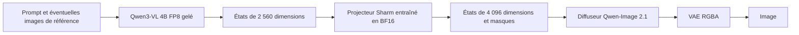

# Plan Sharm : encodeur VL 4B FP8, projecteur et LoRA sprites

Date de l'analyse : 19 octobre 2026. Statut : entraînements lancés ; publication privée autorisée après validation et revue des comparatifs.

## 1. Décisions fixées avec l'utilisateur

- Marque : **Sharm**.
- Compte Hugging Face : **ethanzxv** ; les deux dépôts de modèles resteront **privés**.
- Qwen3-VL 4B reste **gelé en FP8**. On entraîne le projecteur qui adapte ses représentations au diffuseur.
- Le modèle Sharm général est stabilisé et publié avant d'entraîner le LoRA de sprites.
- Chaque lot cohérent de modifications du code ou de la documentation est commité et poussé sur GitHub. Les poids et caches sont conservés hors Git.

Les deux livrables HF proposés sont `ethanzxv/Sharm-Image-2.1-VL4B-FP8` et `ethanzxv/Sharm-Image-2.1-Sprites-128-LoRA`. Ces noms sont des destinations prévues, pas des dépôts déjà créés.

Le mot « retraining » désigne ici une **distillation des représentations vers un MLP entraînable**. Les poids du VL 4B et du diffuseur restent gelés pendant cette adaptation. Le 8B fourni avec Qwen-Image-2.1 sert uniquement d'enseignant hors ligne ; le modèle livré et les générations utilisent exclusivement le 4B avec son projecteur.

## 2. Architecture et faisabilité



Le [4B officiel](https://huggingface.co/Qwen/Qwen3-VL-4B-Instruct/blob/main/config.json) a une largeur de 2 560. Le `transformer/config.json` local impose `context_in_dim=4096`. Le MLP doit donc effectuer une projection **2 560 → 4 096**. Adapter la taille ne suffit pas : les coordonnées, l'amplitude et la signification de ces représentations doivent aussi être alignées.

Un [checkpoint officiel 4B FP8](https://huggingface.co/Qwen/Qwen3-VL-4B-Instruct-FP8) existe. Son [format déclaré](https://huggingface.co/Qwen/Qwen3-VL-4B-Instruct-FP8/blob/main/config.json) est FP8 E4M3, par blocs 128 × 128, avec activations dynamiques. Il conserve des exceptions, notamment la branche vision et la tête de langage. « FP8 » désigne donc les matrices quantifiées du décodeur ; embeddings, normalisations, branche vision et projecteur n'ont pas tous une précision de huit bits.

Politique de chargement : conserver ces exceptions déclarées, geler tout le VL, et interdire une déquantification silencieuse du décodeur en BF16. La sortie du VL et le projecteur peuvent être en BF16. Le diffuseur et le VAE conservent leur propre précision : l'étiquette VL4B-FP8 ne signifie pas que tout le générateur est FP8.

Point à résoudre en premier : la model card FP8 indique encore des limites de chargement direct avec Transformers, alors que le runtime installé possède le backend FP8 correspondant. Sa compatibilité réelle avec ce checkpoint et la RTX 5060 Ti doit être mesurée. Le code installé déclare aussi ce quantificateur non entraînable ; cela convient au VL gelé et à l'entraînement du projecteur sur des features détachées.

Un MLP ne peut pas reconstituer à coup sûr les connaissances perdues avec le passage au 4B. L'architecture est réalisable, mais conserver la qualité générale du modèle est une hypothèse expérimentale à évaluer avant publication.

## 3. Organisation cible de `2-LoRA-qwen`

```text
2-LoRA-qwen/
  README.md
  PLAN_SHARM.md
  01-encoder-distillation/
    configs/
      fp8_encoder.json
      corpus.json
      projector.json
    audit_runtime.py
    prepare_corpus.py
    cache_teacher.py
    cache_student.py
    train_projector.py
    evaluate_alignment.py
    evaluate_generation.py
    refine_projector.py
  02-sprite-lora/
    configs/sprites_512.json
    prepare_dataset.py
    prepare_training_cache.py
    train_lora.py
    evaluate_sprites.py
  common/
    sharm_image21/
      encoder.py
      projector.py
      pipeline.py
      cache.py
      manifests.py
  publish/
    export_base.py
    export_lora.py
    upload_private.py
    model_cards/
  cache/                  # ignoré par Git
  artifacts/              # ignoré par Git
```

Les scripts existants sont déplacés avec leurs références et conservent des lanceurs de compatibilité aux anciens chemins. `common/sharm_image21` porte le même encodage en pré-calcul, entraînement, évaluation et génération. L'application de `1-local-generation` utilise ensuite ce paquet partagé.

## 4. Étape A — figer les références et valider FP8

1. Enregistrer les révisions exactes, les configurations, les versions Python/CUDA/PyTorch et les empreintes des fichiers utilisés.
2. Charger le 4B FP8 seul, sans diffuseur. Encoder un prompt, puis des prompts de longueurs différentes dans un même lot. Contrôler valeurs finies, largeur 2 560, masques et absence de gradients sur le VL.
3. Contrôler les tenseurs et les modules quantifiés réellement chargés, puis sauvegarder et recharger le modèle. Vérifier que le format et les sorties sont conservés avec la tolérance numérique définie pour le backend.
4. Mesurer RAM, VRAM maximale, durée d'encodage et backend effectif sur **SM120**, sans déduire la compatibilité d'un kernel de son seul support des GPU Blackwell de datacenter.
5. Si le checkpoint FP8 officiel ne se charge pas correctement, convertir le 4B BF16 vers un format FP8 pris en charge et sérialisable, puis figer cette révision avant la distillation. Cette variante reste FP8 ; elle exige les mêmes contrôles.

Le [backend FP8 Transformers](https://huggingface.co/docs/transformers/main/quantization/finegrained_fp8) sert de référence de chargement et de sérialisation. Les sorties d'embeddings doivent être accessibles directement ; une API qui renvoie seulement du texte généré ne suffit pas.

Références observées pendant l'analyse :

| Élément | Référence |
| --- | --- |
| Qwen-Image-2.1 et enseignant livré | `d26bb61231c349cf6b7896fa83353113880e1ba3` |
| Qwen3-VL-4B-Instruct-FP8 officiel | `fefbb44cbcce8d1bb7e20b920b94f77432b3446d` |
| Clone Diffusers local | `b800f828f3951c4d206e154411bcbfa693cd322e` |
| Runtime observé | PyTorch 2.14.1+cu130, Transformers 5.20.1, Diffusers 0.41.0.dev0, Accelerate 1.15.0 |

Les dépendances de la livraison seront verrouillées sur la combinaison effectivement validée. Le setup ne mettra pas automatiquement à jour le trainer vers une branche flottante.

**Livrable A :** rapport de compatibilité FP8, empreinte du VL retenu et budget mémoire mesuré. Aucun entraînement long avant ce contrôle.

## 5. Étape B — préserver le contrat d'encodage

L'enseignant est le `text_encoder` exact de Qwen-Image-2.1, avec son processor et son template. Un Qwen3-VL 8B générique n'est pas un remplacement présumé équivalent.

Le [pipeline Diffusers](https://github.com/huggingface/diffusers/blob/main/src/diffusers/pipelines/qwenimage21/pipeline_qwenimage21.py) local prend les états de la dernière couche **avant la RMSNorm finale**. Il utilise un template brut spécifique, du padding à gauche et un découpage des tokens système calculé depuis le processor. Copier seulement `hidden_states[-1]` sans vérifier ces conventions peut produire une cible incorrecte.

Pour chaque exemple, enregistrer : identifiant, prompt exact, tokens, longueurs valides, états avant normalisation, masque d'attention, masque des tokens d'image, révision du processor et convention d'extraction.

Comparer le vocabulaire, les merges et les tokens spéciaux des deux tokenizers ; une même taille de vocabulaire ne prouve pas l'alignement. La distillation token par token commence après contrôle des séquences. Tout désalignement doit être traité explicitement par une correspondance des segments de texte.

Pour l'édition d'image, contrôler aussi les grilles visuelles, le nombre et la position des tokens d'image et le traitement de l'alpha : le pipeline d'origine compose la transparence sur blanc pour la branche vision, tandis que le VAE conserve le RGBA. Les deux encodeurs doivent voir une géométrie compatible. Des embeddings texte seuls ne permettront pas de déclarer la fonction d'édition préservée.

## 6. Étape C — corpus général et caches persistants

Le dataset de sprites contient 770 images et 385 légendes distinctes. Il servira au LoRA de style ; il est trop étroit pour aligner un encodeur général.

Construire un corpus distinct avec provenance et conditions d'utilisation documentées : descriptions courtes et longues, objets, personnes, positions, nombres, couleurs, relations spatiales, texte à afficher, styles, transparence et instructions en français et en anglais. Ajouter des exemples image + instruction pour conserver l'édition. Les catégories et les sources sont réparties entre entraînement, validation et évaluation avant l'extraction ; les variantes proches restent dans le même groupe.

Progression proposée : quelques centaines d'exemples pour contrôler le contrat, **2 000 prompts pour le pilote**, puis **20 000 prompts pour la première distillation générale**. Une extension vers 100 000 dépend des résultats et du temps d'encodage mesuré. Ces volumes sont des points de départ, pas une garantie de qualité.

Pré-calcul en processus séparés :

1. Charger uniquement l'enseignant BF16, extraire les cibles et terminer le processus.
2. Charger uniquement le 4B FP8 final, extraire les features sources et terminer le processus.
3. Entraîner le projecteur depuis ces deux caches, sans charger les grands modèles.

Les caches sont des shards safetensors accompagnés d'un manifeste. Ils conservent les longueurs réelles et permettent une lecture par lots, une reprise et une vérification des shards terminés. La clé d'un cache inclut contenu, tokens, modèle, processor, template, couche, normalisation, format de quantification et, pour les images conditionnelles, transformation et grille.

Éviter les logits de langage et le KV cache pendant l'extraction. Le cache enseignant BF16 conserve la référence originale ; le cache étudiant est produit par le modèle FP8 qui sera réellement livré.

Avec 128 tokens moyens, les deux sorties en BF16 coûtent environ **31,7 Gio pour 20 000 prompts**, ou **158,7 Gio pour 100 000**, hors métadonnées : `N × L × (4096 + 2560) × 2 octets`. Les exemples multimodaux peuvent être beaucoup plus longs ; limiter leur budget par shard et traiter des lots bornés plutôt que tout matérialiser en RAM.

**Livrable C :** corpus versionné, répartition sans fuite et caches reproductibles avec reprise.

## 7. Étape D — entraîner le projecteur

Comparer d'abord une projection linéaire 2 560 → 4 096 à un petit MLP résiduel :

```text
P(h) = Wskip h + W2 GELU(W1 RMSNorm(h))
Wskip : 2560 → 4096
W1    : 2560 → 1024
W2    : 1024 → 4096
```

Ce choix représente environ **17,3 millions de paramètres**, soit **33 Mio en BF16**. La branche linéaire conserve un chemin direct ; la branche non linéaire apprend les corrections. La sortie ne reçoit pas de normalisation qui effacerait l'amplitude attendue par le diffuseur.

Entraîner seulement `P`, avec features sources détachées. Point de départ : AdamW, LR `1e-4` à `3e-4`, warmup de 3 %, clipping à 1, lots groupés par longueur, calcul des pertes et des statistiques en FP32. Ajuster le nombre de tokens par lot après mesure mémoire ; choisir le checkpoint sur validation.

La perte combine une erreur quadratique rapportée à l'énergie de la cible et une distance cosinus. Contrôler séparément les normes. Exclure le padding, équilibrer le poids des exemples et les catégories, et surveiller les queues de distribution : une bonne moyenne ne doit pas masquer l'échec des longs prompts ou de la typographie.

Évaluer le MLP face à la projection linéaire sur des données réservées : erreur relative, cosinus, ratio de normes, longueur, langue et catégorie. Le MLP doit apporter un gain mesurable avant d'être retenu. Une faible erreur d'embedding ne prouve pas encore la qualité des images.

**Livrable D :** `projector/config.json`, poids safetensors, historique et rapport comparatif.

## 8. Étape E — valider et éventuellement affiner dans le diffuseur

Comparer le pipeline original et le pipeline Sharm avec mêmes prompts, graines, résolution, sampler et nombre de pas. Réserver des prompts absents du corpus : composition, comptage, couleurs, texte, transparence, scènes longues et édition.

Pour la première exécution texte vers image, quatre prompts de validation du projecteur sont choisis avant génération, par catégories fixées. Le diffuseur est chargé en NF4 et le VAE en BF16 des deux côtés ; seuls les embeddings du VL 8B BF16 et du VL 4B FP8 + projecteur diffèrent. Les références en cache conservent leurs identités d’encodeur et empreintes. Les évaluations plus larges sur des prompts entièrement nouveaux et l’édition restent à réaliser.

Mesurer le suivi des consignes, les erreurs de contenu et la qualité de l'alpha ; conserver les images comparatives et les chiffres. Fixer la tolérance de régression sur cette référence avant le run principal. L'égalité pixel à pixel entre deux encodeurs différents n'est pas un objectif réaliste.

Si l'alignement des features est correct mais que les images se dégradent, ajouter une phase d'affinage du MLP guidée par le **diffuseur gelé** : mêmes latents bruités et timesteps, prédiction avec les embeddings enseignant comme cible, puis prédiction avec les embeddings projetés. L'erreur entre prédictions fournit un signal adapté à la tâche.

Les cibles d'embeddings sont déjà en cache : le VL 8B reste absent de cette phase. Le gradient du second passage traverse le diffuseur jusqu'au MLP, ce qui exige de conserver des activations même si les poids du diffuseur sont gelés. Batch 1 et checkpointing sont donc à mesurer avant extension.

Si le MLP reste insuffisant, étendre le corpus ou la capacité du projecteur et recommencer les comparaisons. Le plan conserve la contrainte du **4B gelé** ; il ne bascule pas vers son fine-tuning. La qualité du 8B ne sera pas revendiquée sans résultats.

**Livrable E :** candidat général évalué, incluant une validation multimodale avant de déclarer l'édition prise en charge.

## 9. Étape F — intégrer et exporter la base Sharm

Créer un loader/pipeline Sharm qui encapsule le VL 4B FP8, l'extraction correcte, le MLP et les masques. Le diffuseur reçoit toujours une largeur de 4 096. Utiliser ce même chemin dans l'application et pour les futurs caches LoRA.

Le loader vérifie la quantification et les empreintes. Il charge les composants avec leurs précisions respectives, sans conversion globale du pipeline en BF16. Un modèle ou un backend incompatible doit produire une erreur explicite au lieu de recharger le 8B ou de déquantifier le 4B.

Le paquet de base HF contiendra :

```text
model_index.json
sharm_config.json
text_encoder/         # 4B FP8 et échelles de quantification
processor/            # processor validé avec les conventions Sharm
projector/            # config et poids BF16 entraînés
transformer/          # poids du diffuseur d'origine
vae/
scheduler/
README.md
LICENSE
NOTICE
LICENSE.encoder
training_manifest.json
checksums.json
footprint.json         # tailles réelles des poids et réduction de la base
base-validation.json
comparisons/encoder/   # références 8B / 4B, PNG RGBA, damier et manifeste
```

Le paquet Python Sharm et sa version sont documentés et figés dans la model card ; le code nécessaire au chargement est livré ou référencé à une révision immuable. Le chargement stock `QwenImage21Pipeline.from_pretrained` ne sera pas annoncé suffisant tant qu'il ne sait pas appliquer le projecteur.

L'export est autonome : il ne demande pas de télécharger l'encodeur 8B. Après export, le recharger depuis un dossier propre et reproduire les essais d'encodage et de génération.

## 10. Étape G — publication HF privée sous ethanzxv

Utiliser une authentification locale via `HF_TOKEN` ou le gestionnaire HF, sans secret dans le code, les configs, les URLs Git ou les logs. Le runtime est authentifié sur `ethanzxv` ; les dépôts cibles ont été créés en privé et leur confidentialité a été contrôlée.

Vérifier le compte authentifié, créer `ethanzxv/Sharm-Image-2.1-VL4B-FP8` avec `private=True`, et vérifier la confidentialité aussi si le dépôt existe déjà. Le [client HF](https://huggingface.co/docs/huggingface_hub/guides/upload) envoie uniquement la liste des fichiers d'export. Les caches, datasets, checkpoints d'optimiseur et fichiers d'authentification sont exclus.

Après l'envoi, contrôler l'intégrité et recharger depuis la révision distante exacte avec authentification. Enregistrer cette révision pour le LoRA. Le dépôt reste privé ; un nom ou un tag de version ne change pas sa visibilité.

La [licence Qwen-Image-2.1](https://huggingface.co/Qwen/Qwen-Image-2.1/blob/main/LICENSE) autorise une redistribution sous conditions pour des usages non commerciaux et impose attribution, notices et signalement des modifications. Elle demande aussi une mention « Built with Qwen » ou équivalente et interdit Qwen comme nom principal d'un dérivé. La marque Sharm convient à ce dernier point. Conserver également les éléments Apache-2.0 de l'encodeur 4B. La combinaison ne devient pas intégralement Apache-2.0 grâce au changement d'encodeur.

**Livrable G :** base Sharm privée, rechargeable sans 8B, avec révision HF et rapport d'évaluation.

## 11. Étape H — LoRA de sprites sur cette base

1. Reprendre les 770 sprites RGBA et auditer les cas de fond bleu discontinu. La suppression actuelle vise la couleur exacte `#A5EBFF`, indépendamment de la connexion au bord ; vérifier aussi quelques sprites contenant du bleu pour détecter une suppression de couleur légitime.
2. Répartir les données par **espèce** : les deux variantes d'un Pokémon appartiennent au même ensemble pour éviter une fuite entre entraînement et validation.
3. Pré-calculer les embeddings avec le **4B FP8 + projecteur final**, à la révision de la base privée. Une légende partagée par deux sprites reçoit une seule entrée de cache. Les 385 légendes restent utiles même si certaines sont réservées à l'évaluation.
4. Pré-calculer séparément les latents VAE des images. Leur empreinte comprend résolution, image RGBA et transformations. Changer la résolution invalide les latents ; changer le VL ou le projecteur invalide les embeddings.
5. Entraîner les adaptateurs du diffuseur en chargeant les paires embeddings/masques et latents. Le bruit et les timesteps sont tirés à chaque étape. Le VL et le projecteur ne sont pas nécessaires en mémoire pendant cette boucle.
6. Point de départ : entraînement 512 × 512, batch 1, accumulation 4, rank/alpha 8, LR `1e-4`, checkpointing, diffuseur NF4 et 500 pas pour le premier essai. Les 500 pas ne constituent pas une durée définitive ; choisir ensuite selon les générations et la validation.
7. Viser un **PNG RGBA final 128 × 128**. Comparer la génération 512 puis réduction nearest-neighbor à une génération native 128. Le VAE compresse spatialement par 16 : 128 ne laisse qu'une grille latente 8 × 8. Les sources 64 × 64 n'apportent pas de détails natifs supplémentaires lorsqu'elles sont agrandies.
8. Évaluer silhouette, identité demandée, cadrage, netteté, grille de pixels et alpha sur des espèces et descriptions réservées. La réduction nearest-neighbor, seule, ne garantit pas que tous les pixels générés suivent une grille parfaite.

Publier ensuite le LoRA validé dans `ethanzxv/Sharm-Image-2.1-Sprites-128-LoRA`, **privé**. Sa model card et ses métadonnées indiquent l'identifiant de base, la révision HF et l'empreinte du couple VL/projecteur. Le loader contrôle cette compatibilité avant application.

La fiche du LoRA présente les six premières espèces distinctes de validation, chacune **sans puis avec LoRA**, avec les mêmes embeddings Sharm, prompt, graine, réglages et réduction nearest-neighbor 512 → 128. Le LoRA est chargé après toute la passe sans adaptateur. Le premier candidat recommande un poids de 0.5 après une comparaison à 1.0 sur ces mêmes espèces ; les défauts de formes et d’identité sont signalés. Les PNG RGBA 128 px et 512 px sont conservés, avec un aperçu séparé sur damier pour montrer l’alpha. Les réglages, versions du runtime et empreintes des images sont joints à `comparisons/lora/comparison.json`.

La galerie VL 8B / VL 4B de la base est également copiée dans `comparisons/encoder/` du LoRA. Les deux fiches expliquent l’objectif de **compacter la base** et chiffrent les tailles réelles des poids de l’encodeur avec projecteur et de la base complète. Les comparaisons visuelles restent distinctes d’une mesure de vitesse ou de VRAM. La demande actuelle autorise la publication HF privée après entraînement, validation et revue visuelle, suivie d’une vérification des fichiers distants et d’une génération avec le loader publié.

## 12. Ressources et ordre d'exécution

Machine observée : RTX 5060 Ti, 16 Gio de VRAM, capacité CUDA 12.0 ; WSL dispose d'environ 15 Gio de RAM et 8 Gio de swap. Environ 2 Gio de VRAM étaient occupés lors de cette analyse.

Les [métadonnées du 4B FP8 officiel](https://huggingface.co/api/models/Qwen/Qwen3-VL-4B-Instruct-FP8) indiquent environ 3,63 milliards de paramètres FP8 et 1,19 milliard BF16, plus les échelles FP32 : environ **6 Go de tenseurs**, pas 4 Go pour tout le VL. Le modèle complet Sharm devrait occuper de l'ordre de **21–22 Go de poids** avec le diffuseur BF16 et le VAE, à confirmer à l'export. Ce volume disque ne prédit pas la VRAM maximale.

| Phase | Grands modèles nécessaires | Stratégie |
| --- | --- | --- |
| Cibles enseignant | VL 8B d'origine seul | BF16, chargement par couches avec budget GPU/CPU ; petits lots |
| Features étudiantes | VL 4B FP8 seul | checkpoint FP8 final, extraction sans gradients |
| Distillation principale | Aucun grand modèle | MLP et shards lus par lots |
| Affinage par diffusion éventuel | Diffuseur gelé | embeddings en cache, batch 1, checkpointing |
| LoRA sprites | Diffuseur et adaptateurs | embeddings et latents en cache, base NF4 |
| Génération livrée | VL 4B FP8, MLP, diffuseur, VAE | chargement par étapes ou offload selon les mesures |

Le 8B enseignant pèse environ 17,5 Go sur disque. Le chargement CPU/GPU doit éviter sa matérialisation simultanée en plusieurs copies. Si la limite WSL empêche ce pré-calcul, relever son plafond vers 22 Go après avoir libéré suffisamment de RAM côté Windows. Le swap ne remplace pas un budget RAM adapté. Aucune durée totale n'est annoncée avant le pilote : extrapoler encodage, entraînement et génération depuis les temps et tailles réels.

Ordre des lots GitHub :

1. Plan et décisions d'architecture.
2. Réorganisation, module partagé et audit FP8.
3. Corpus, manifests et extraction des deux caches.
4. Projecteur, entraînement et évaluation des représentations.
5. Intégration de génération, validation et affinage éventuel du MLP.
6. Export autonome et outils de publication privée de la base.
7. Caches et entraînement LoRA sprites sur la base figée.
8. Intégration dans l'application et publication privée du LoRA validé.

Chaque lot comporte ses contrôles adaptés, son commit et son push sur `origin`. Les poids et les résultats lourds sont versionnés dans les dépôts HF privés, avec un lien explicite vers le commit de code correspondant.

Le premier point de décision technique sera donc la compatibilité du **4B FP8 réel avec l'extraction pré-normalisation**. Le second sera la qualité d'un **projecteur appris sur un corpus général**, mesurée en génération avant le LoRA de style.
