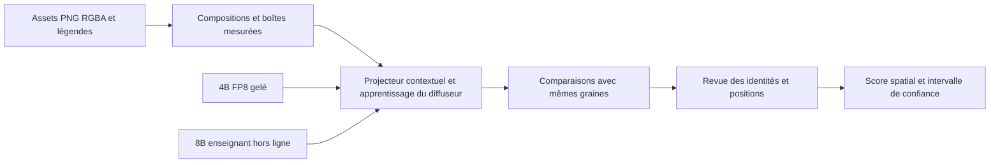

# Sharm : VL 4B FP8 gelé, projecteur et LoRA sprites

## Comprendre le projet en notebooks

Le [parcours numéroté de 00 à 06](notebooks/README.md) explique l'architecture, les données, le vrai FP8, les formules de MSE, l'entraînement, les galeries RGBA, le LoRA et la publication. Il appelle les scripts existants et lit les vrais résultats disponibles. Les calculs et envois sont désactivés par défaut ; les résultats finaux sont ajoutés après leur obtention et conservés dans [reports/](reports/README.md), avec leurs empreintes et la révision HF immuable.

## Sharm Image Monster Pixel Art : nouvelles données

Le [dataset Monster nettoyé](02-sprite-lora/dataset/README.md) contient **4 481 PNG RGBA uniques de 128 × 128, couvrant 649 espèces**, issus des 25 fichiers fournis. Le découpage, les formes, les vues, les palettes, les doublons et les définitions FR/EN sont documentés et audités. Les données prêtes à utiliser sont dans `02-sprite-lora/dataset/prepared/monster-clean-v2/` ; cette préparation n'a pas encore servi à un nouvel entraînement du LoRA Monster. La chaîne spatiale de **Sharm Image Base** conserve son corpus et ses caches actuels sur le serveur SSH.

## Nouveau candidat : positions et compositions RGBA

La chaîne [03-spatial-distillation](03-spatial-distillation/README.md) ajoute un **candidat expérimental** : corpus RGBA avec positions mesurées, projecteur avec attention entre tokens, boîtes de contrôle optionnelles, puis apprentissage guidé par les images et les trajectoires du 8B. Le 4B reste réellement chargé et gelé en FP8 ; les composants entraînables utilisent le calcul BF16 et des poids maîtres FP32. Un LoRA du diffuseur est optionnel.



Les expériences utilisent `artifacts/spatial/` et `cache/spatial/`. La nouvelle chaîne produit des candidats locaux. La demande actuelle prévoit de publier le candidat terminé sur **`ethanzxv/Sharm-Image-2.1-VL4B-FP8`**, après revue et vérification du loader livré, en conservant la visibilité du dépôt. Voir le [protocole d'export spatial](publish/README.md). **Aucun nouveau résultat de précision spatiale n'est encore établi.** Le profil `8gb.json` vise une RTX 5060 Laptop 8 Go à 256 px ; le profil `16gb.json` propose 512 px. Ces budgets demandent un audit réel du passage arrière avant tout entraînement long.

La reprise actuelle s’exécute sur le serveur SSH de 16 Go avec le profil `remote16gb-256.json`, qui conserve les 3 600 scènes et les pas du profil 8 Go. Voir [la migration et son schéma](03-spatial-distillation/REMOTE.md).

Les explications sont réparties dans les README de [l'alignement initial](01-encoder-distillation/README.md), [la spécialisation sprites](02-sprite-lora/README.md), [la nouvelle chaîne spatiale](03-spatial-distillation/README.md), [l'architecture partagée](common/sharm_image21/README.md) et [la publication](publish/README.md).

Le projet comprend deux entraînements successifs : aligner les représentations du Qwen3-VL 4B FP8 gelé avec le diffuseur Qwen-Image-2.1 grâce à un projecteur entraînable, puis entraîner un LoRA sprites sur cette base figée. Le [plan détaillé](PLAN_SHARM.md) documente les choix et les limites.

## Première base entraînée et publiée

La première base [Sharm Image 2.1 VL4B FP8](https://huggingface.co/ethanzxv/Sharm-Image-2.1-VL4B-FP8) a été publiée **en privé** sous `ethanzxv`, à la révision `1e912f5a1e5df40bdaf927abf3e4220d73781321`. Les 56 fichiers avaient été vérifiés contre leurs tailles et empreintes distantes ; l'accès anonyme était refusé. Les chiffres ci-dessous décrivent cette révision historique, distincte du nouvel entraînement spatial.

Le projecteur a effectué 1 000 pas linéaires puis 5 000 pas MLP. Après export BF16, les 2 049 prompts de validation donnent une erreur relative de `0.13739`, un cosinus de `0.92500` et un ratio de normes de `0.93580`. Le MLP est le candidat retenu. Son empreinte est `a414685b8f1c0b305ffeb0dc286afb47b168fc03a5be9d2832ff820fec678883`.

Les fichiers safetensors de la base passent de **33,12 Go à 21,64 Go**, soit **−34,66 %**. Le conditionneur avec son projecteur passe de 17,53 Go à 6,06 Go, soit −65,46 %. Ces tailles en octets décimaux excluent configurations, caches et LoRA. Les quatre comparaisons 8B/4B figurent sur la fiche HF, avec les observations : texte OPEN conservé et transparence de la fleur maintenue, mais une composition vélo/bateau plus fusionnée et des détails du vélo moins stables avec le 4B. La base reste expérimentale en texte vers image.

## Installer et lancer

Depuis la racine du dépôt, sur WSL avec le runtime Qwen et CUDA :

```bash
./2-LoRA-qwen/setup_sharm.sh
./2-LoRA-qwen/start_training.sh
```

Le lancement se détache du terminal et exécute les étapes dans des processus séparés. Il reprend les shards et checkpoints déjà terminés. Une seconde invocation détecte la chaîne déjà active.

Pour lire son état :

```bash
./1-local-generation/.venv-qwen/bin/python ./2-LoRA-qwen/run_training.py --status
```

Les journaux sont dans `artifacts/logs/`. `artifacts/run-status.json` contient le PID, l’étape active, la révision de code et les versions installées. Les fichiers `cache-*-status.json`, `projector-status.json` et `lora-status.json` donnent la progression de chaque calcul. Garder WSL et la machine en fonctionnement pendant les entraînements.

## Chaîne exécutée

1. Vérifier les poids source aux révisions figées et préparer les sprites locaux.
2. Préparer 20 000 prompts : 18 115 prompts DiffusionDB (CC0-1.0), 1 500 compositions rédigées par templates et 385 légendes sprites. La répartition enregistrée contient 17 951 exemples d’entraînement et 2 049 de validation.
3. Contrôler le 4B FP8 réel. Le checkpoint officiel quantifie le décodeur et garde des exceptions déclarées en BF16, dont la branche vision. L’encodage du 4B se fait un prompt à la fois pour conserver les mêmes conditions de calcul entre cache et génération.
4. Extraire les cibles du VL 8B d’origine et les features du 4B en deux passes distinctes. Le 8B sert uniquement d’enseignant hors ligne. Les états extraits précèdent la dernière RMSNorm et conservent les tokens et masques attendus.
5. Entraîner une projection linéaire pendant 1 000 pas, puis le MLP résiduel pendant 5 000 pas. Seul le projecteur reçoit des gradients. Son candidat retenu est enregistré en BF16 et évalué après cette conversion.
6. Comparer les embeddings, les prédictions du diffuseur et des générations réservées. Si les contrôles échouent, la chaîne s’arrête avant le LoRA et écrit la cause dans son état.
7. Exporter et recharger la base Sharm complète, avec son 4B FP8, son projecteur et les composants de diffusion.
8. Pré-calculer les embeddings projetés et les latents RGBA des sprites, puis entraîner le LoRA pendant 500 pas, batch 1 avec accumulation 4, rang/alpha 8, diffuseur NF4 et optimiseur 8-bit.
9. Produire des échantillons sur des espèces réservées, en 512 px et en 128 px après réduction nearest-neighbor. Les deux variantes d’une espèce appartiennent au même ensemble pour éviter une fuite de validation.

La première base est expérimentale et validée uniquement pour le texte vers image. L’édition par image nécessite encore un alignement et une évaluation multimodaux ; le loader refuse cette fonction dans cette version. Les contrôles automatiques de génération ne remplacent pas la revue visuelle des images et de l’identité des sprites.

Le cache 8B utilise des lots de 16 pour amortir le transfert des couches déportées en RAM. Le 4B FP8 garde son encodage un prompt à la fois. `run_training.py --teacher-batch-size 4` permet de revenir aux petits lots sur une machine disposant de moins de mémoire ; les shards déjà écrits restent réutilisables.

Le LoRA recalcule par défaut les activations d’un bloc sur deux (`--checkpointing-mode alternating`). Le recalcul intégral a mesuré un pic PyTorch d’environ 4,7 Gio ; sa désactivation a atteint 14,3 Gio et ralenti le calcul sur cette carte 16 Gio. `--gradient-checkpointing` ou `--checkpointing-mode all` conserve la variante la plus économe ; `--checkpointing-mode none` reste disponible pour une carte plus grande. Ce réglage est enregistré dans la configuration et ne change pas les exemples, le nombre de pas ou la compatibilité des checkpoints.

## Confidentialité et sorties

Les poids de modèles, caches et artefacts d'exécution locaux sont hors Git. Les PNG sources et le dataset Monster validé sont versionnés sous `02-sprite-lora/dataset/`, avec leurs définitions, rapports et galerie. La publication spatiale actuelle vise uniquement `ethanzxv/Sharm-Image-2.1-VL4B-FP8`. L'export local est `artifacts/spatial/release/` et sa demande est enregistrée dans `artifacts/spatial/publication-request.json`. Les deux destinations de la chaîne historique étaient :

- `ethanzxv/Sharm-Image-2.1-VL4B-FP8` ;
- `ethanzxv/Sharm-Image-2.1-Sprites-128-LoRA`.

Les exports locaux sont `1-local-generation/weights/sharm-image-2.1-vl4b-fp8/` et `1-local-generation/weights/sharm-image-2.1-sprites-128-lora/`. Leur révision de projecteur est enregistrée afin de vérifier la compatibilité du LoRA. Le loader fourni est `sharm_image21.pipeline.SharmImage21Pipeline` ; le chargement stock ne suffit pas pour ajouter le projecteur.

Pour enregistrer une génération en PNG RGBA avec un aperçu lisible sur damier, le loader propose `generate_png` :

```python
image = pipeline.generate_png(
    "A small pixel-art dragon, centered",
    "dragon.png",
    preview_path="dragon-preview.png",
    transparent_background=True,
    width=512,
    height=512,
    output_resolution=512,
    num_inference_steps=30,
    true_cfg_scale=1.0,
)
```

Le loader demande un fond transparent et vérifie que l’alpha contient bien des pixels transparents avant d’écrire le fichier. Si l’image générée reste opaque, il signale l’échec au lieu de présenter un PNG opaque comme une image détourée. Le PNG conserve son canal alpha ; l’aperçu damier sert à le visualiser dans un navigateur ou une fiche HF.

La licence Qwen Research et les attributions d’origine sont conservées. Aucun jeton HF n’est nécessaire pour entraîner depuis les poids publics. Une authentification locale du compte `ethanzxv` sera nécessaire pour envoyer ultérieurement les exports en privé.

## Comparaisons sur les fiches HF

La fiche du LoRA contiendra deux galeries générées par la chaîne après les entraînements :

- **Avant / après LoRA** : six espèces réservées à la validation, même base Sharm avec le VL 4B FP8 et son projecteur. Tous les rendus sans adaptateur sont calculés avant de charger le LoRA, puis les mêmes prompts sont rejoués avec l’adaptateur. Le premier candidat recommande une force de **0.5**, retenue après comparaison à 1.0 sur ces six prompts. Le style et la transparence évoluent, avec encore des défauts de silhouettes et d’identité ; la fiche les expose.
- **VL 8B d’origine / VL 4B FP8 + projecteur** : quatre prompts de validation générale, sans LoRA des deux côtés. Cette galerie figure aussi sur la fiche de la base Sharm.

Chaque paire partage exactement le prompt, la graine CUDA réinitialisée, la résolution, le scheduler, le nombre de pas et le CFG. Le diffuseur est chargé en NF4 avec calcul BF16 et le VAE en BF16 des deux côtés. Les sprites sont générés en 512 px puis réduits de la même façon en 128 px, en nearest-neighbor. Les aperçus utilisent un damier ; les PNG à télécharger conservent leur alpha et aucune retouche n’est appliquée aux générations.

`evaluate_sprites.py --lora-weight 0.5` calibre la force d’inférence sans réentraîner les poids. La passe sans LoRA est réutilisée uniquement si ses empreintes et réglages correspondent. La force recommandée est enregistrée dans `sharm_lora_config.json` et l’exemple de chargement la transmet avec `attention_kwargs={"scale": ...}`.

Les images réelles, leurs empreintes, prompts, graines, réglages complets et versions du runtime sont copiés dans `comparisons/lora/` et `comparisons/encoder/` des exports. Une galerie absente, altérée ou incompatible avec les empreintes du projecteur ou du LoRA bloque l’assemblage de la fiche.

Les fiches expliquent que le **remplacement du VL vise à compacter le modèle de base**. Elles chiffrent la taille réelle des poids safetensors de l’encodeur avec projecteur et de la base complète dans `footprint.json`. Les gains de VRAM, de vitesse et la conservation de la qualité doivent être évalués séparément. La génération et l’export de ces fiches s’intègrent aux étapes déjà prévues.

## Publication historique et rechargement

`publish/publish_private.py` attend la fin de la chaîne et une revue visuelle liée aux empreintes exactes des galeries. Il compose une liste explicite des fichiers à envoyer : poids finaux, loader, dépendances figées, notices, rapports et comparatifs. Les checkpoints d’optimiseur, caches et données source sont exclus.

```bash
./1-local-generation/.venv-qwen/bin/python ./2-LoRA-qwen/publish/publish_private.py --verify-inference
```

L’authentification est lue dans le gestionnaire local HF. Le compte `ethanzxv` et la confidentialité sont contrôlés avant chaque envoi. La base est publiée en premier ; le LoRA référence ensuite sa révision HF immuable. Les tailles et empreintes distantes sont comparées aux fichiers locaux, les fiches et manifestes sont relus via HF et l’accès anonyme doit échouer. Une génération finale utilise le loader livré dans le miroir de ces révisions vérifiées.

La base peut être envoyée dès son propre entraînement validé et ses images revues, pendant que le LoRA travaille : utiliser `--component base`, puis `--component lora --verify-inference` une fois le LoRA terminé et revu. Cette seconde invocation vérifie de nouveau la base publiée et réutilise sa révision exacte.

`artifacts/publication-request.json` conserve la demande actuelle ; `publication-status.json` contient les révisions publiées et la progression. Le rapport de publication met à jour l’état final après la vérification du LoRA.

## Dataset sprites historique : six planches

Les six planches locales `21228.png`, `21229.png`, `21230.png`, `21231.png`, `21301.png`, `21650.png` fournissent **1 540 sprites de 64 × 64, couvrant 384 espèces**, palettes normale et shiny. La disposition a été corrigée : Unown et Spinda sont absents, Castform possède quatre cellules par palette et Celebi est présent. Les noms ne sont plus décalés après les espèces manquantes. Voir [les correspondances et la préparation](02-sprite-lora/README.md).

La préparation enlève tous les pixels exacts `#A5EBFF`, y compris les îlots de fond isolés, et conserve le RGBA. Les copies d'entraînement sont agrandies en nearest-neighbor. `dataset/sources.json` conserve les empreintes des six originaux ; les légendes distinguent les palettes shiny et les formes de Castform.

```bash
./1-local-generation/.venv-qwen/bin/python ./2-LoRA-qwen/prepare_dataset.py \
  --sheet-dir ./2-LoRA-qwen/02-sprite-lora/dataset/raw --training-size 512
```

Les planches source sont désormais versionnées dans `02-sprite-lora/dataset/raw/`. Le répertoire historique `2-LoRA-qwen/dataset/` et ses traits PokéAPI mis en cache restent locaux. Le nouveau dataset Monster complet est versionné séparément dans `02-sprite-lora/dataset/prepared/monster-clean-v2/`. Les sources 64 px ne créent pas de détails natifs supplémentaires lors d’un agrandissement vers 128 px.

Pour relancer seulement le LoRA après validation de la base et préparation des caches :

```bash
./2-LoRA-qwen/train_lora.sh
```

Le runtime de référence utilise PyTorch 2.14.1+cu130, Transformers 5.20.1, Diffusers à la révision figée et `kernels==0.17.2`. Le test `verify_training.py --diffusion` vérifie un apprentissage synthétique du projecteur, la sauvegarde/relecture des caches et un vrai passage avant/arrière du diffuseur NF4 avec adaptateurs LoRA.
