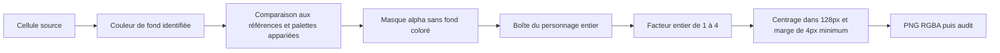

> Exécution actuelle : ouvrir [le notebook Monster](../Sharm_Image_2_1_VL4B_LoRA_Monster.ipynb), sections Données, Préparation et Audit. Les références aux scripts ci-dessous documentent la recette historique qui a produit cette version signée ; ces sources restent dans l’historique Git. Les PNG, manifestes et rapports de cette version conservent leurs octets.

# Données — Sharm Image Monster Pixel Art

## Version prête à utiliser

**`prepared/monster-clean-v2/`** contient **4 481 PNG RGBA uniques**, couvrant **649 espèces**. Ils proviennent de **4 508 cellules**, dans **24 planches distinctes** sur 25 fichiers fournis. Toutes les cellules sont comptabilisées. Les originaux restent dans `raw/`.

| Répartition des images uniques | Nombre |
|---|---:|
| Style Emerald | 1 534 |
| Style Black/White | 2 947 |
| Face | 3 011 |
| Dos | 1 470 |
| Palette normale | 2 409 |
| Palette shiny | 2 072 |
| Entraînement | 4 084 images / 583 espèces |
| Validation | 397 images / 66 espèces |

Ces nombres utilisent la légende principale de chaque image. Lorsqu'une image correspond à plusieurs variantes identiques, `equivalent_variants` conserve les autres identités valides sans répéter l'image dans l'entraînement. Le corpus fourni ne contient pas toutes les variantes possibles : les deux planches Sinnoh sont en palette normale.

## Organisation

```text
dataset/
├── README.md
├── current.json                     # version validée et empreinte du manifeste
├── raw/                             # les 25 PNG fournis, inchangés
├── reference/                       # références de contrôle, sans ajout au corpus
└── prepared/monster-clean-v2/
    ├── dataset.json                 # statistiques et empreintes
    ├── audit.json                   # contrôle effectif des images et métadonnées
    ├── sources.json                 # SHA-256, grilles et révisions des références
    ├── source_cells.jsonl           # chacune des 4 508 cellules et sa provenance
    ├── manifest.jsonl               # définition complète de chaque image
    ├── manifest.csv                 # vue tabulaire compatible avec le cache LoRA
    ├── definitions.json             # index des espèces et formes, noms FR/EN
    ├── caption-corpus.jsonl          # textes uniques et identifiants du cache 4B
    ├── duplicates.json              # 27 cellules regroupées et variantes associées
    ├── unresolved.json              # vide pour cette version
    ├── images_128/                  # cibles PNG RGBA
    ├── train_256/                   # mêmes images agrandies exactement ×2
    ├── train_512/                   # mêmes images agrandies exactement ×4
    ├── quarantine/                  # réservé aux futures cellules non vérifiées
    └── review/                      # galerie HTML et planches contact légendées
```

Chaque dossier d'images contient `metadata.jsonl`, `train.jsonl` et `validation.jsonl`. Les listes de splits désignent les fichiers du même dossier. Les PNG sources, le dataset validé, les rapports, scripts, catalogues et README sont versionnés dans Git. Les références téléchargées et brouillons restent locaux. `.gitattributes` préserve les octets des datasets sur Windows et Linux pour conserver leurs empreintes.

## Planches sources

| Région d'origine des espèces | Face normale / shiny | Dos normal / shiny |
|---|---|---|
| Kanto, combat 96px | `48056` / `48057` | `48052` / `48053` |
| Johto, combat 96px | `48064` / `48065` | `48060` / `48061` |
| Hoenn, combat 96px | `48072` / `48073` | `48068` / `48069` |
| Sinnoh, combat 96px | `48080` / absent | `48076` / absent |
| Unova, combat 96px | `48088` / `48089` | `48084` / `48085` |

Les six autres planches sont les sprites de combat Emerald à 64px : Kanto `21230/21231`, Johto `21229/21301`, Hoenn `21228/21650`, normal puis shiny. Johto y omet Unown et Hoenn y omet Spinda ; Castform y possède quatre cellules météorologiques. Les nouvelles planches couvrent ces espèces absentes de la série ancienne.

Le doublon de fichier `48088 (1).png` est vérifié par SHA-256 et n'est pas redécoupé. Les crédits, étiquettes et dessins en pied de planche sont exclus des exemples.

## Découpage et transparence



- Planches récentes : huit colonnes, cellules de 96 × 96, pas vertical de 103. Les sept pixels suivants portent les numéros et suffixes ; ils sont exclus des images.
- Anciennes planches : dix colonnes, cellules de 64 × 64, origine `(5, 5)`, pas de 69. L'ordre est une table auditée, pas un simple décalage du numéro de cellule.
- Le texte des 2 968 cellules récentes est décodé exactement avec `monster_label_font.json`. Espèce, sexe et indices de forme sont recoupés entre face/dos et normal/shiny.
- Le bleu ancien est explicitement `#A5EBFF`. Le coin supérieur gauche n'est pas pris comme vérité : l'aile de la seconde pose d'Artikodin l'occupe. Pour les planches récentes, le fond est déduit des bords de la cellule.
- Les pixels opaques conservent leurs valeurs RGB sources. Le RGB des pixels entièrement transparents est mis à zéro.
- Le personnage garde son ratio, est agrandi par un **facteur entier** et centré sur 128px. Aucun lissage, étirement ou agrandissement fractionnaire.

## Définitions et légendes

L'identité est séparée des observations d'image. Chaque définition contient :

| Champ | Sens |
|---|---|
| `species_id`, `name_en`, `name_fr` | numéro canonique et noms PokéAPI |
| `form_id`, `form_identifier`, `form_name_en/fr` | forme précise : météo, lettre, saison ou autre variante |
| `gender` | mâle/femelle lorsque la source le distingue, sinon non spécifié ou asexué |
| `view` | face ou dos de la planche source |
| `palette` | normale ou shiny, sans couleur normale attribuée à tort aux shiny |
| `sprite_style` | Emerald ou Black/White |
| `palette_rgb` | couleurs mesurées, comptes de pixels et proportions |
| `body_shape_taxonomy`, `types_taxonomy` | classification de référence, explicitement distincte d'une annotation visuelle |
| `source_cells` | empreintes, coordonnées, texte imprimé et méthode de vérification |
| `equivalent_variants` | variantes partageant exactement les mêmes pixels cibles |

Les légendes d'entraînement sont en anglais et suivent le même ordre :

```text
sharm_monster, pixel art monster sprite, Bulbasaur, normal palette,
front view, Black-and-White-style battle sprite. Single complete character,
crisp pixel edges, transparent background.
```

La forme et le sexe s'ajoutent lorsqu'ils sont déterminés. Des descriptions françaises sont aussi fournies dans le manifeste. Les légendes excluent capacités, histoires et comportements du Pokédex, non observables dans les pixels. Les couleurs sont mesurées par image et ne viennent pas d'une couleur générique de l'espèce.

## Vérifications et limites

| Méthode principale des images uniques | Nombre |
|---|---:|
| Pixels composités comparés exactement, canaux normalisés en 5 bits | 4 250 |
| Étiquette source + fond absent de la palette opaque des références | 101 |
| Masque exact de l'autre palette de la même pose | 18 |
| Table historique auditée + fond cyan distinct des couleurs 15 bits | 112 |

Le passage en 5 bits compare la palette représentée par `v << 3` dans les planches et par une expansion vers 0–255 dans les références. Ce n'est pas une tolérance MSE. Les pixels livrés restent ceux des planches originales.

Les 17 étiquettes d'Arceus sont liées à l'ordre des types de la génération V. La forme normale ne peut ainsi pas être confondue avec l'ancienne forme « ??? », dont certaines références ont des pixels identiques. Toute autre ambiguïté d'identité arrête la préparation.

Les 231 images hors première méthode ne sont pas présentées comme des correspondances pixel par pixel aux références. Leurs preuves sont enregistrées individuellement. Les 34 cellules en attente après les premières passes ont aussi été examinées visuellement **par l'agent** en comparaison source/découpe. Ce travail et les audits automatiques ne sont ni une annotation humaine ni une évaluation statistique d'un modèle.

L'audit contrôle les 13 443 PNG livrés : RGBA, alpha, marges, facteurs entiers, conservation des couleurs sources, versions 256/512, empreintes, noms/formes/sexes imprimés, métadonnées et absence de fuite d'espèces entre les splits. Les 4 508 cellules sont comptabilisées, doublons inclus.

## Références figées

Les originaux sont les fichiers fournis localement. [PokéAPI Sprites](https://github.com/PokeAPI/sprites) sert au contrôle indépendant de l'identité, de la palette et de l'alpha ; ses images ne sont pas ajoutées au corpus.

- Sprites : révision `7a7d66b1620e646f69afd48dc1273da9033ede9c`.
- Taxonomie et noms : [PokéAPI](https://github.com/PokeAPI/pokeapi), révision `6fd69dfe90465ba96534f6816fc817737d1f97f6`.
- Sprites vérifiés par empreinte Git blob ; CSV et planches par SHA-256. Verrous dans `sources.json` et `reference/reference-lock.json`.

## Reproduire

Voir les trois commandes du [README du LoRA](../README.md). `--raw-dir`, `--reference-dir`, `--output-dir` et `--catalog` permettent d'autres emplacements. Un fichier non catalogué, un doublon qui change, une étiquette inconnue ou une incohérence d'identité provoquent un arrêt explicite.

Le dataset spatial utilisé par **Sharm Image Base** reste sous `2-LoRA-qwen/artifacts/spatial/dataset/`. Cette préparation Monster crée un corpus distinct ; elle ne remplace pas les données ni les caches de la chaîne Base en cours.
