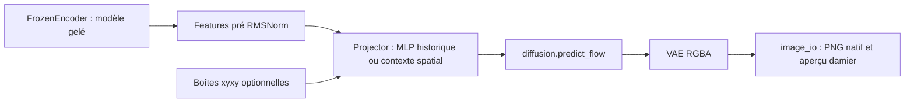

# Architecture commune de Sharm

`core.py` définit les identités, les caches, l'encodeur et le projecteur. Le format historique est conservé : `context_layers=0` et `layout_enabled=False` gardent les mêmes paramètres et la même arithmétique. Les nouvelles configurations enregistrent explicitement leur nombre de blocs et leur support des boîtes ; `Projector.load` lit les deux formats.

Le projecteur contextuel ajoute une position sinusoïdale et de l'attention bidirectionnelle entre tokens déjà contextualisés par le VL. Son masque signale les tokens valides, pas les tokens à masquer. Avec des boîtes, `forward(hidden, layout=boxes)` ajoute un token par objet, constitué de sa boîte normalisée et de son numéro. Les coordonnées doivent être finies, ordonnées, comprises entre 0 et 1, avec une surface positive. Leur ordre doit correspondre aux objets numérotés dans le prompt.

Le texte et les tokens de layout forment ensemble le conditionnement du diffuseur. L'alignement d'embeddings s'applique uniquement à la portion texte ; la supervision des tokens de layout vient de la perte du diffuseur. Les séquences doivent rester dans l'ordre : le sous-échantillonnage aléatoire de tokens du trainer MLP historique ne convient pas au trainer contextuel.

`diffusion.py` charge le diffuseur NF4 avec calcul BF16 et expose `predict_flow`, utilisable avec gradients vers le projecteur et, si présent, le LoRA. `FeatureCache` conserve des tenseurs détachés sur disque et vérifie leur identité. L'encodeur FP8 n'est jamais traversé par le backward.

Pour l'extraction de features textuelles, les couches de langage du 4B restent en FP8 sur CUDA ; son bloc vision et sa tête de prédiction de texte sont conservés en RAM car cet extracteur ne les exécute pas. Cela libère de la VRAM sur la carte de 8 Go. Cette disposition concerne le conditionnement texte et ne valide pas une utilisation avec des images d'entrée. `torchvision` est requis par le processeur multimodal Qwen, même dans ce parcours textuel.

`pipeline.py` charge la base historique et les exports `spatial-v1`. Ces derniers acceptent `layout=[{"label": ..., "box": [x0,y0,x1,y1]}, ...]` et contrôlent l'empreinte du projecteur et du LoRA éventuel. L'encodeur est libéré avant le chargement du projecteur, puis le diffuseur est chargé séparément pour limiter le pic mémoire. La convention du prompt avec boîtes est partagée dans `spatial_data.layout_prompt`.

`03-spatial-distillation/infer.py` reste le point d'entrée d'un candidat local avec `candidate.json`. L'export et les contrôles de rechargement sont expliqués dans [le README de publication](../../publish/README.md).

`image_io.py` sauvegarde l'alpha natif. Le damier est un aperçu séparé ; la transparence n'est jamais simulée dans le fichier téléchargeable. Les générations opaques sont conservées dans le benchmark afin d'y compter comme échecs. L'inférence PNG demandant la transparence signale leur échec.
