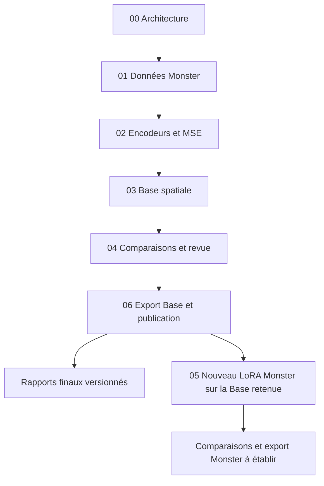

# Parcours Sharm en notebooks

Un parcours en français pour comprendre, observer et reproduire les étapes de **Sharm Image Base**, puis la spécialisation **Monster Pixel Art**. Les notebooks appellent les scripts du projet : leurs paramètres, reprises et contrôles restent communs à la chaîne exécutée sur le serveur.

## Ordre de lecture

| Notebook | Contenu |
|---|---|
| [00 — Vue d'ensemble](00_vue_ensemble.ipynb) | Architecture, différence Base/Monster, versions du code et du kernel |
| [01 — Dataset Monster](01_dataset_monster.ipynb) | PNG sources, découpage, alpha, définitions, légendes, splits et empreintes |
| [02 — Encodeurs et MSE](02_encodeurs_et_mse.ipynb) | FP8 réel, enseignant 8B, caches, formules et limites des métriques |
| [03 — Base spatiale](03_base_spatiale.ipynb) | Profil, warmup, flow, historique, courbe et reprise distante |
| [04 — Générations et évaluation](04_generations_et_evaluation.ipynb) | Galerie appariée complète, damier, revue, positions et évaluation humaine |
| [05 — LoRA Monster](05_lora_monster.ipynb) | Identité de la Base, caches dédiés, paramètres et entraînement du nouveau LoRA |
| [06 — Publication et versions](06_publication_et_versions.ipynb) | Loader exporté, deux inférences RGBA, HF, archive Git et révisions immuables |



## Ouvrir et lire

Ouvrir un fichier `.ipynb` dans un éditeur compatible Jupyter, avec un kernel Python. Les cellules de lecture utilisent la bibliothèque standard, IPython et Pillow ; Matplotlib est facultatif pour la courbe. Les bibliothèques GPU viennent de l'environnement figé dans [`requirements-sharm.txt`](../requirements-sharm.txt). Le notebook 00 affiche les versions effectivement utilisées.

Depuis le kernel, le dossier courant doit être la racine du dépôt, `2-LoRA-qwen/`, ou un de ses sous-dossiers. Les chemins sont résolus automatiquement et restent relatifs au projet dans les sources versionnées. Aucun hôte SSH, mot de passe ou jeton n'est nécessaire pour lire les notebooks et les rapports archivés.

La structure est disponible pendant l'entraînement. **Les résultats finaux ne sont ajoutés qu'après leur obtention réelle.** Un rapport absent est signalé comme absent. Le nouveau dataset Monster est préparé ; cela n'annonce pas un nouvel entraînement Monster terminé.

## Observer puis reproduire

Les actions de téléchargement, reconstruction des données, calcul GPU et publication possèdent chacune un drapeau `RUN_... = False`. L'exécution ordinaire des notebooks affiche les commandes et lit les résultats disponibles. Modifier explicitement le drapeau correspondant lance l'action dans le Python du kernel.

Pour les actions GPU, utiliser le kernel CUDA **du workspace Linux distant**, attendre la fin de toute chaîne active et définir `SHARM_NOTEBOOK_GPU=1` dans cet environnement. Le helper refuse le calcul GPU Windows et une nouvelle chaîne lorsqu'un trainer est détecté. Les verrous des runners restent actifs. L'entraînement en cours continue dans son processus détaché ; il n'est pas migré dans un kernel interactif.

La procédure d'installation et de reprise est dans [REMOTE.md](../03-spatial-distillation/REMOTE.md). L'authentification HF et le push final restent dans le gestionnaire canonique Windows. Les cellules n'installent pas de dépendances et ne changent pas les poids ou caches à l'ouverture.

## Résultats et rangement

```text
2-LoRA-qwen/
├── notebooks/                  # explications et commandes, sorties de cellules nettoyées
├── 01-encoder-distillation/    # scripts d'alignement et audit FP8
├── 02-sprite-lora/
│   └── dataset/               # sources et versions validées du dataset
├── 03-spatial-distillation/    # scripts et profils de la Base spatiale
├── publish/                   # export, vérification et envoi
├── reports/                   # résultats finaux revus, avec manifestes SHA-256
├── artifacts/                 # états, calculs, sorties temporaires : hors Git
└── cache/                     # features et latents : hors Git
```

Les notebooks lisent d'abord le rapport final sélectionné dans `reports/current.json`. En son absence, ils peuvent afficher les petits artefacts locaux disponibles. Un relevé du serveur porte sa date ; il n'est pas présenté comme un état en direct. La galerie finale permet de parcourir chaque candidat avec les homologues 8B, sans réduire le nombre de scènes ou de graines.

Le script [archive_spatial_results.py](archive_spatial_results.py) conserve les résultats après publication vérifiée ; voir [le format des rapports](../reports/README.md). Il ne fabrique pas de revue et n'attribue pas de validation statistique humaine à une inspection par agent.

## Git

- Versionner les notebooks, scripts, profils, README, schémas, sources PNG, données validées et rapports finaux.
- Garder les poids sur la destination HF autorisée, identifiés par une révision immuable.
- Garder secrets, environnements, caches, journaux, optimiseur et brouillons hors Git.
- Nettoyer les sorties avant commit : `python 2-LoRA-qwen/notebooks/clean_notebooks.py` depuis la racine.
- Examiner le diff, créer un commit Angular en anglais et pousser sur `origin/main`, selon [AGENTS.md](../../AGENTS.md).

Les aperçus d'exécution restent hors des cellules versionnées ; les résultats à conserver sont des fichiers explicites dans `reports/`, avec leurs empreintes. Les règles `.gitattributes` préservent leurs octets sur Windows et Linux.
