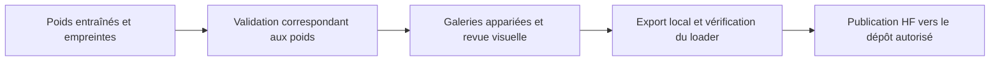
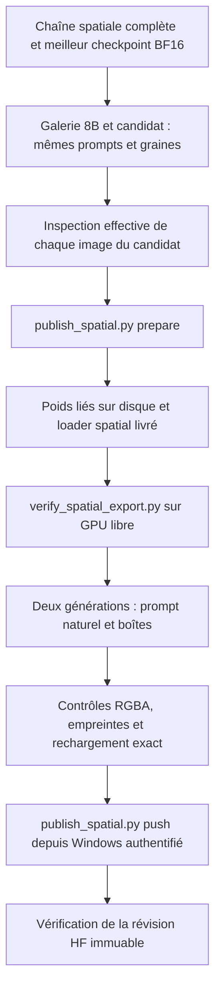

# Export et publication

Lecture guidée : [notebook 06 — Publication et versions](../notebooks/06_publication_et_versions.ipynb). Après l'envoi vérifié, archiver les résultats selon [reports/README.md](../reports/README.md), puis committer et pousser les rapports et notebooks sur `main`.



## Candidat spatial actuel

La destination autorisée est **`ethanzxv/Sharm-Image-2.1-VL4B-FP8`**. Sa visibilité est conservée : le dépôt était privé au moment de la demande. `artifacts/spatial/publication-request.json` enregistre le compte, la destination et la révision de départ, sans jeton. Le jeton est lu dans le gestionnaire local Hugging Face.



### Revue et portée des résultats

`03-spatial-distillation` produit `artifacts/spatial/run/flow/best/` et une galerie dans `run/validation/`. La fin numérique de l'entraînement ne valide pas la qualité spatiale.

Avant l'export, `artifacts/spatial/visual-review.json` doit identifier le reviewer et le protocole (`agent_visual_review` ou `human_visual_review`), les empreintes exactes du projecteur et de la galerie, les `reviewed_ids` de **toutes** les images du candidat et la conclusion `passed`. Ce fichier est rédigé après inspection réelle des identités, positions, séparations et transparence ; garder les défauts et observations dans le rapport. Une galerie insatisfaisante demande une correction et de nouvelles générations.

Une revue par agent ne constitue pas l'évaluation humaine statistique de `03-spatial-distillation/evaluate.py`. La fiche conserve `spatial_quality_validated: false` tant que ce protocole indépendant n'a pas été satisfait. Elle présente le périmètre expérimental et les comparaisons sans annoncer de parité générale avec le 8B ni de positions parfaites.

### Préparer et vérifier

Depuis la racine du projet, après la chaîne complète et la revue :

```powershell
.\.venv-spatial-check\Scripts\python.exe .\2-LoRA-qwen\publish\publish_spatial.py prepare
```

L'export est assemblé dans `artifacts/spatial/release/`. Les gros poids sont liés au même volume pour économiser le disque. Il inclut le 4B FP8, les composants du diffuseur, le projecteur BF16 retenu, son LoRA éventuel, le loader compatible avec `layout=[{label, box}]`, les licences et les comparaisons. La convention des prompts avec coordonnées est partagée avec l'inférence locale et contrôlée contre le corpus.

Lancer ensuite dans WSL avec le GPU libéré par l'entraînement :

```bash
HF_HUB_OFFLINE=1 ./1-local-generation/.venv-qwen/bin/python \
  ./2-LoRA-qwen/publish/verify_spatial_export.py
```

Ce contrôle importe le **code copié dans l'export**, compare exactement les poids rechargés au candidat, encode avec le vrai FP8, puis génère un exemple naturel et un exemple avec boîtes. Il exige deux PNG RGBA contenant un sujet et un fond transparent. Le damier est enregistré séparément. Le rapport `export-validation.json` est lié aux empreintes de l'export ; une modification impose une nouvelle vérification.

### Publier

Dans le terminal Windows déjà authentifié :

```powershell
.\.venv-spatial-check\Scripts\python.exe .\2-LoRA-qwen\publish\publish_spatial.py push
```

L'envoi utilise une liste explicite de fichiers et vérifie le compte, la visibilité, les empreintes et l'absence de modifications HF concurrentes. Les caches, données, optimiseur et identifiants sont exclus. Après l'envoi, tailles et SHA-256 des fichiers LFS sont vérifiés sur la révision immuable ; les petits fichiers sont relus et hachés. `artifacts/spatial/publication-status.json` reçoit la révision finale uniquement après ces contrôles. Une reprise peut vérifier une publication identique déjà envoyée.

## Collecter un export vérifié sur le serveur SSH

Après l'entraînement, la revue et `verify_spatial_export.py` sur le serveur, recevoir les petits fichiers dans `artifacts/spatial/remote-release/`. Pour rsync, exclure `transformer/*.safetensors`, `vae/*.safetensors` et `text_encoder/*.safetensors` ; conserver les poids du projecteur et du LoRA éventuel, les rapports, images, configurations et code.

```powershell
.\.venv-spatial-check\Scripts\python.exe .\2-LoRA-qwen\publish\collect_remote_release.py
```

Le collecteur vérifie le manifeste de l'export distant et son rapport GPU. Il contrôle chaque fichier reçu ainsi que les gros poids locaux correspondants avant d'assembler la release. Il relie les poids publics locaux au même volume et conserve les octets exacts du code et des rapports testés sur le serveur. Un mauvais SHA-256, un rapport absent ou un chemin externe interrompt l'assemblage. Le résultat est prêt pour la commande `publish_spatial.py push` ; cette collecte ne relance pas l'inférence et n'envoie rien vers HF.

## Chaîne historique

`export_base.py`, `publish_private.py` et leurs vérificateurs concernent la base MLP historique et le LoRA sprites. Ils conservent leur protocole et leurs sorties séparées. Leurs seuils d'alignement d'embeddings ne suffisent pas à valider les positions du nouveau candidat spatial.
