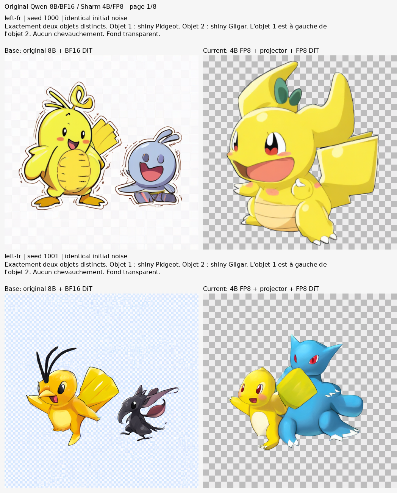
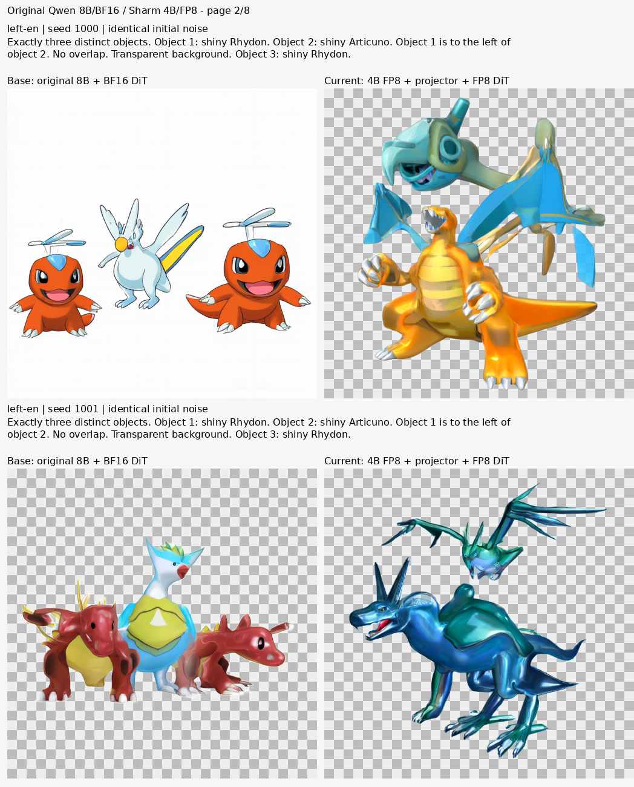
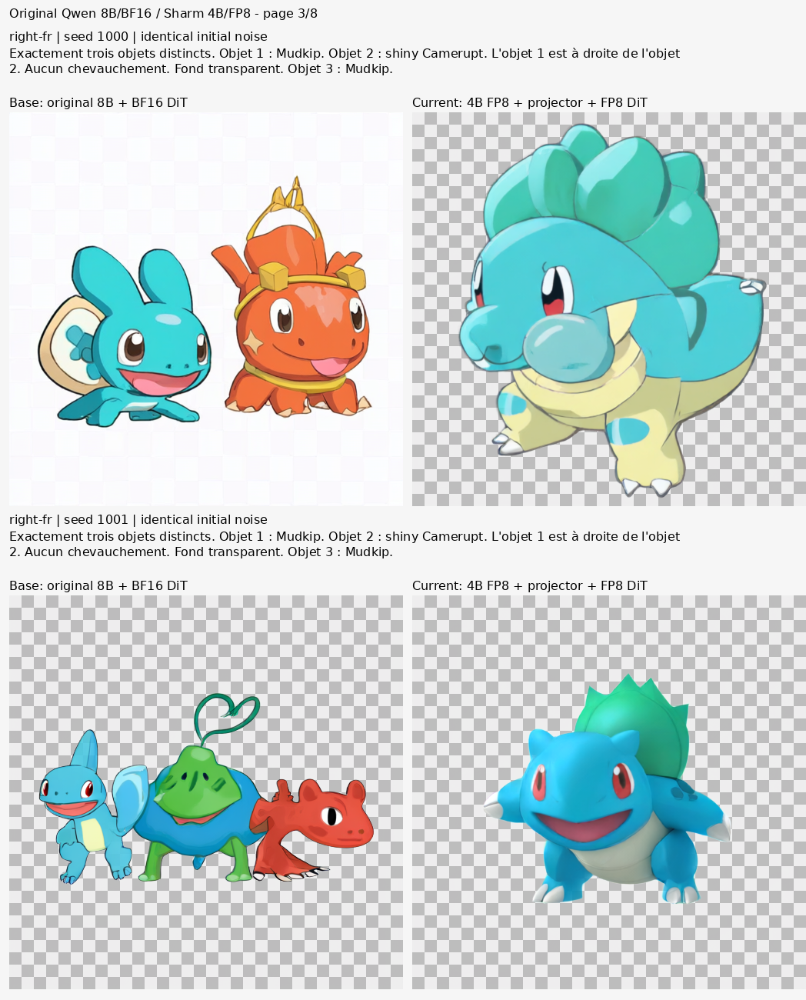
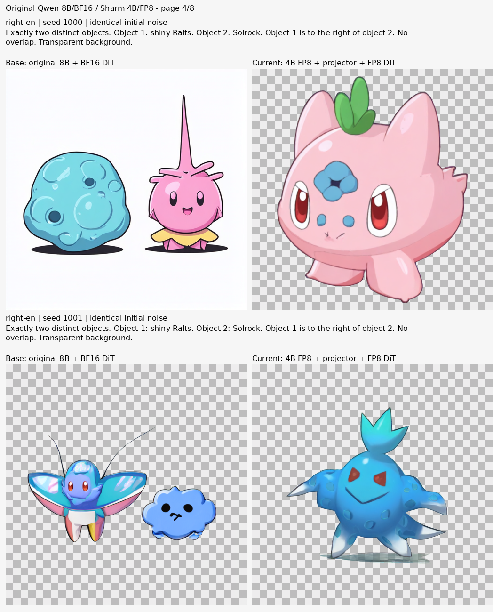
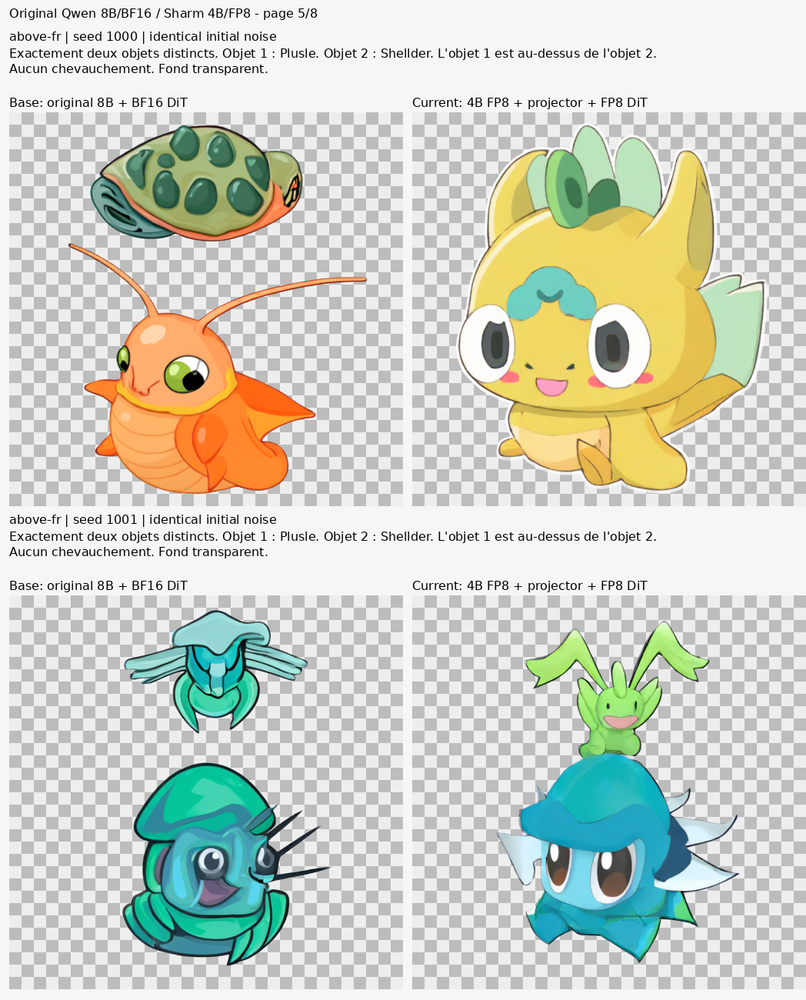
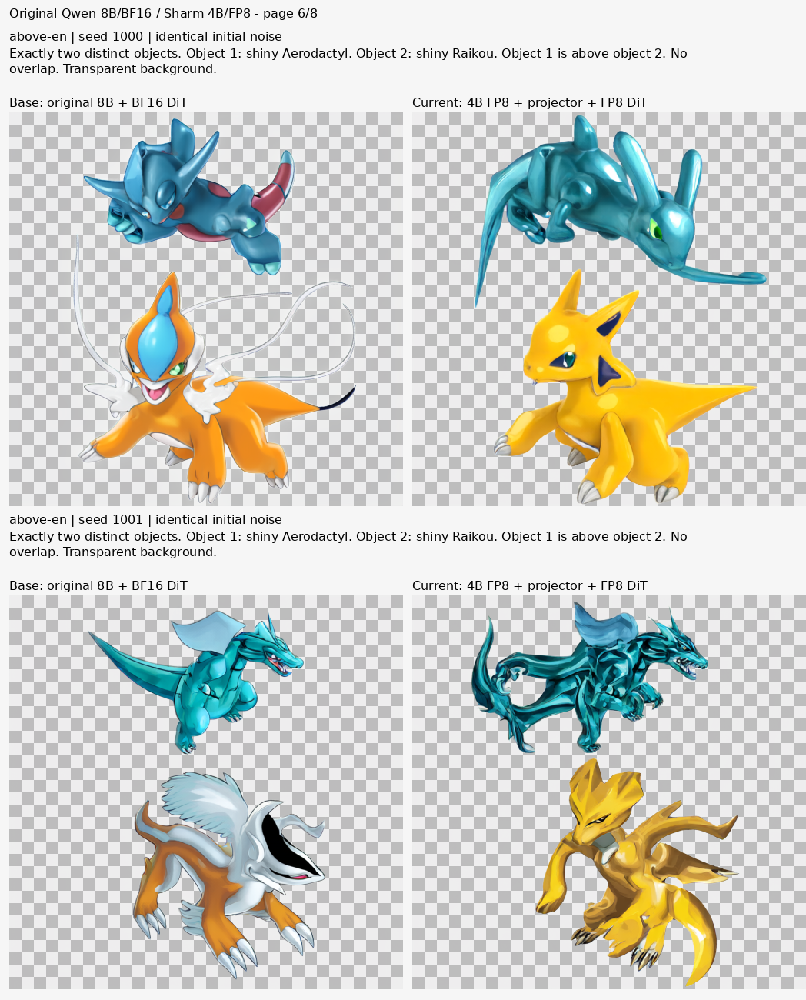
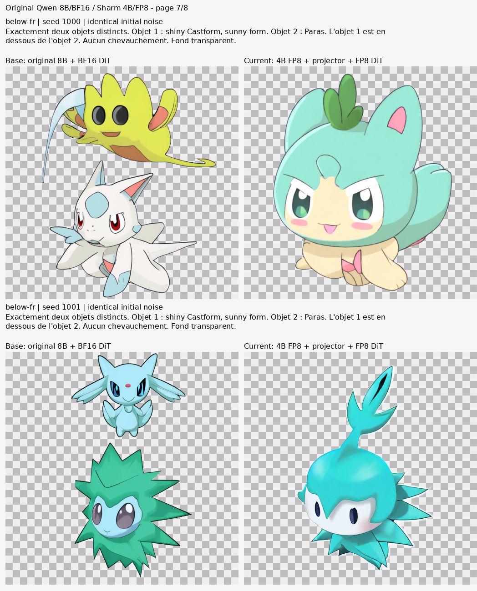
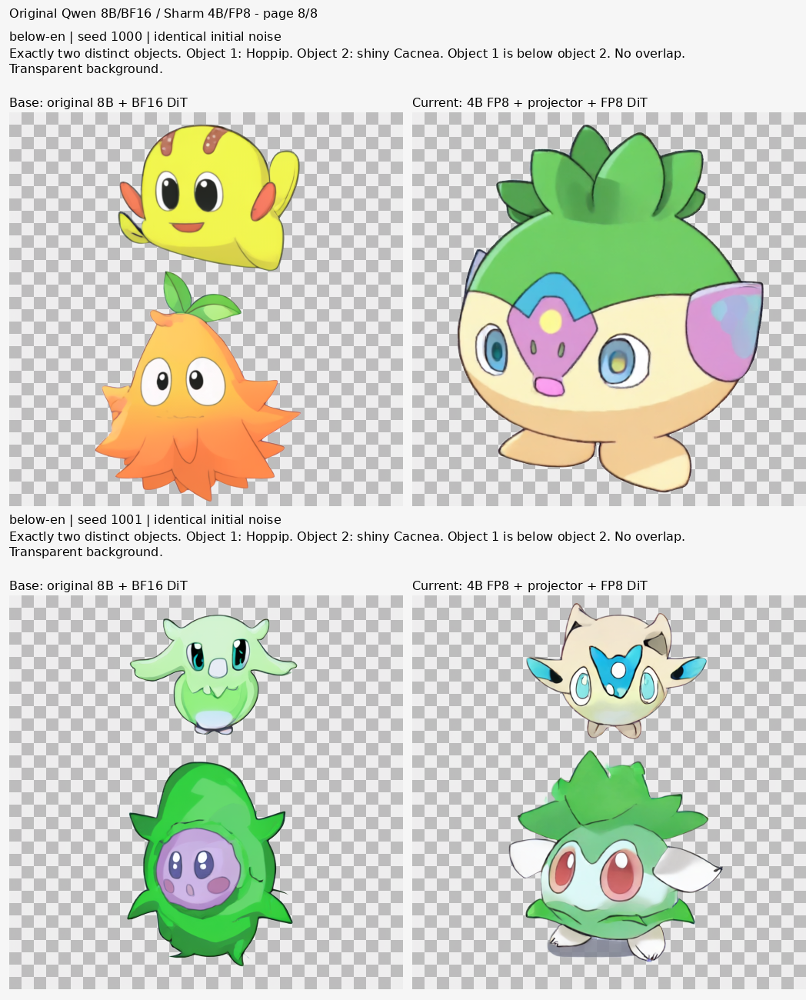

# Modèle de base / modèle Sharm actuel

**16 paires, 32 PNG originaux**, tous conservés. Référence : `Qwen/Qwen-Image-2.1` à `d26bb612`, encodeur 8B BF16 et vrai DiT BF16. Modèle actuel : Sharm Image à `a0c0e168`, encodeur 4B FP8, projecteur `a414685b` et DiT FP8 natif. Aucun candidat spatial refusé, aucun LoRA.

Le protocole fixe avant génération huit prompts de validation : quatre relations (gauche, droite, dessus, dessous) × français/anglais, deux graines, 512 px, 30 pas, **CFG 1**, sans prompt négatif ni KV cache. Le bruit initial est sauvegardé et identique pour chaque paire. Les conditionnements sont volontairement différents : ils proviennent des deux encodeurs comparés.

Les vraies features 8B BF16 pré-calculées sont réutilisées, avec identité d'encodeur, index, tokens et empreintes enregistrés. Leur convention avant RMSNorm correspond au pipeline Qwen officiel de la révision Diffusers figée. Cela évite de retélécharger les poids 8B. Le vrai DiT de référence reste intégralement BF16 : il passe sur GPU pour débruiter, puis sur CPU pour laisser le VAE décoder. **Ces conditions ne permettent pas une comparaison complète de vitesse ou de VRAM des deux modèles.**

[Galerie à taille native](gallery.html) · [Protocole](protocol.json) · [Sources et identités](sources.json) · [Audits des vrais dtypes](loader-audits.json) · [Écarts numériques](metrics.json) · [Revue identifiée](visual-review.json).

Les MSE d'images et d'embeddings sont des différences numériques, sans vérité terrain. Les PNG ne sont pas des annotations de positions et l'enseignant n'est pas une vérité terrain. La revue par agent et la validation humaine statistique restent distinctes. Les cas difficiles sont conservés ; aucune promesse de positions parfaites n'est faite. Les PNG RGBA restent inchangés, les damiers sont uniquement des aperçus.

## Toutes les paires

