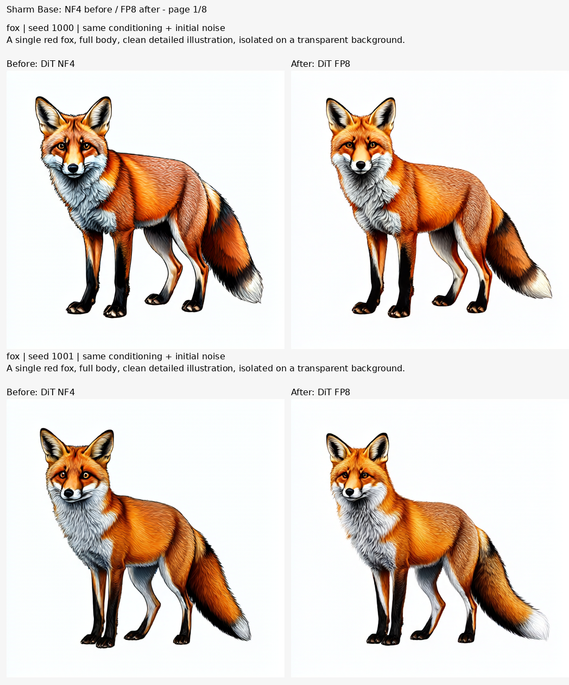
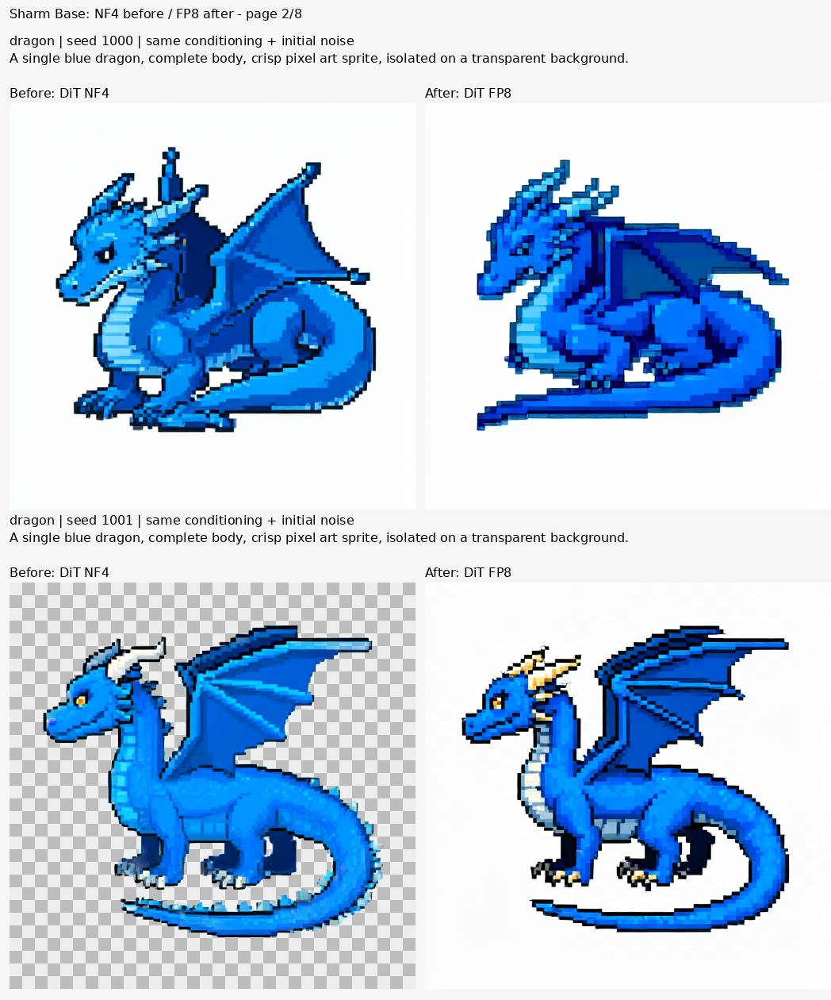
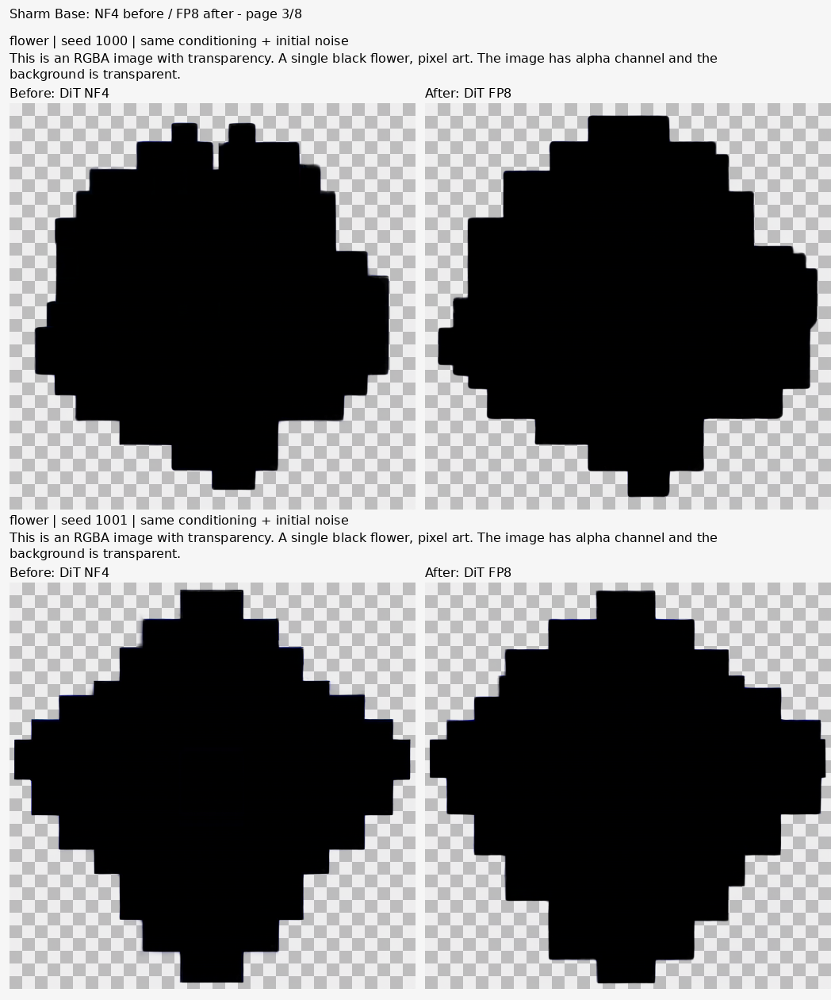
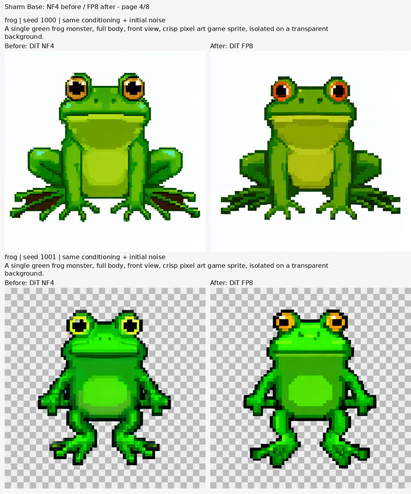
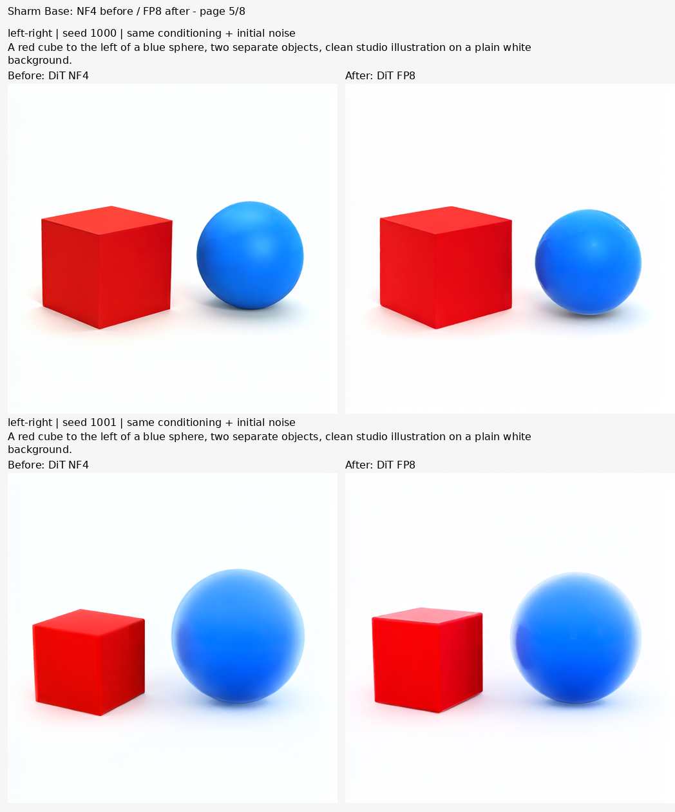
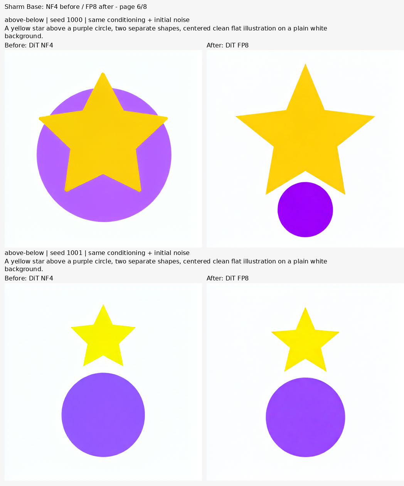
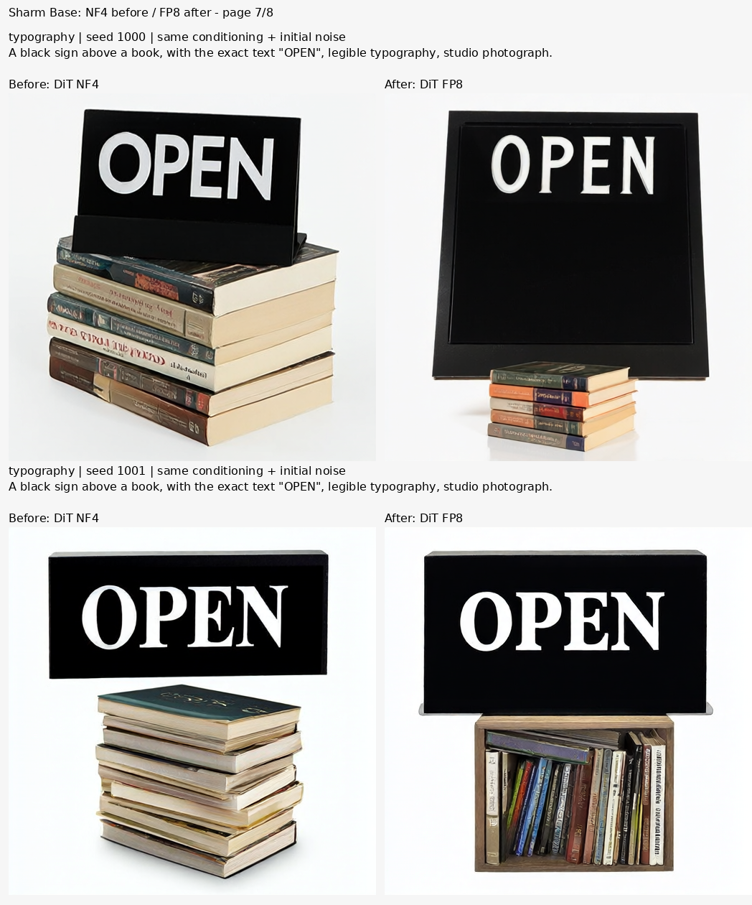
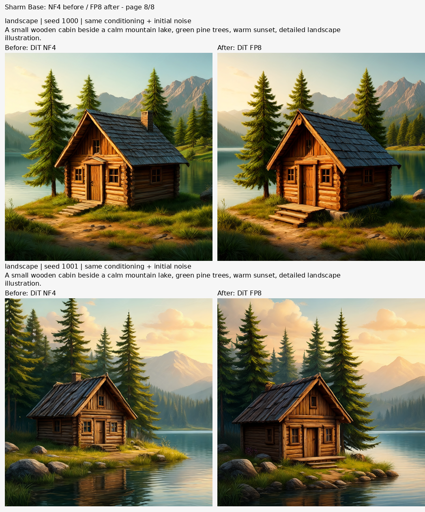

# Même Sharm : ancien DiT NF4 / nouveau DiT FP8

Le text encoder Qwen3-VL 4B et son projecteur sont identiques. Les images partagent aussi les mêmes embeddings, prompts et bruits de départ. Le test couvre 8 prompts et 2 graines : **16 paires, 32 PNG**, 512 × 512, 30 étapes, CFG 3.

| Mesure sur ce test | NF4 | FP8 |
| --- | ---: | ---: |
| Temps médian génération + décodage | 26,43 s | 20,90 s |
| Pic de mémoire GPU mesuré | 5,73 Gio | 8,95 Gio |

Un passage par modèle ne constitue pas un benchmark général. La génération FP8 perd le fond transparent du dragon à la graine 1001. Les mesures de pixels ne disent pas si une image est meilleure ; aucune position parfaite n’est garantie.

[Galerie interactive](gallery.html) · [Réglages](protocol.json) · [Mesures](metrics.json) · [Revue identifiée](visual-review.json) · [SHA-256](manifest.json).

## Toutes les paires

