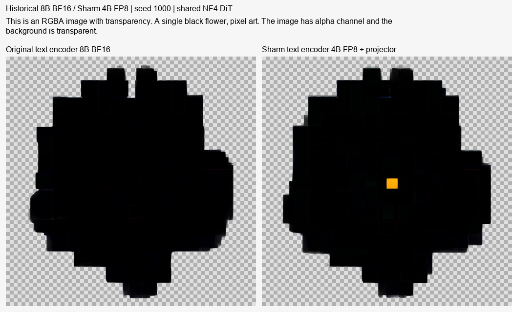
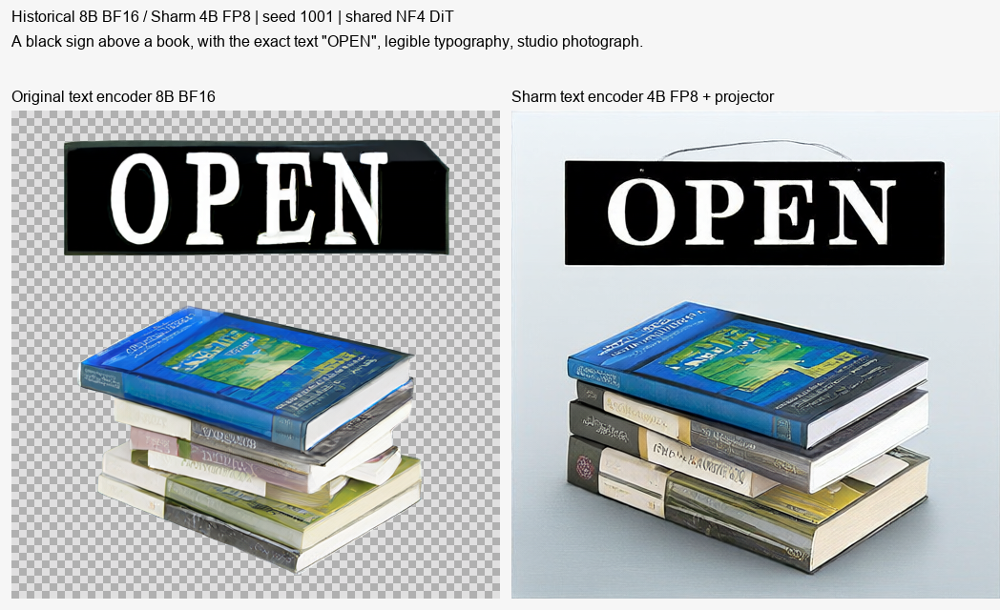
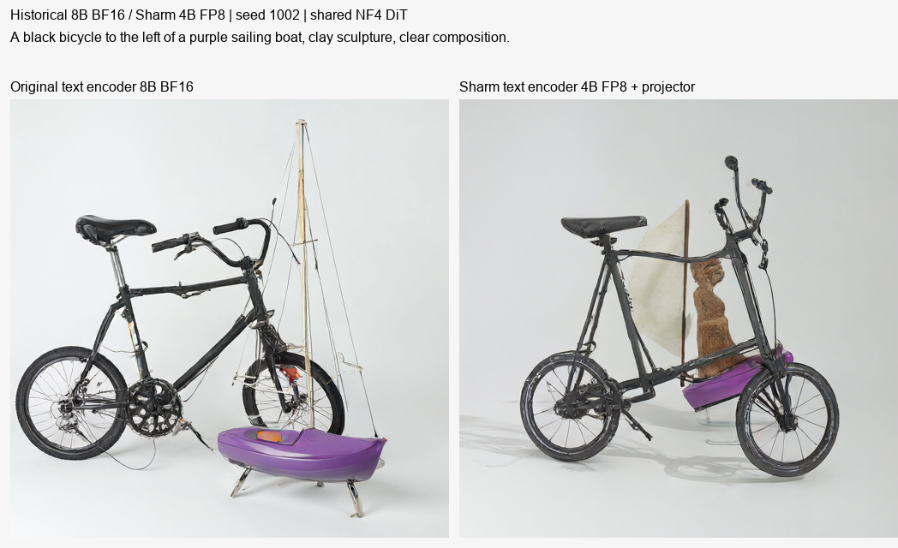
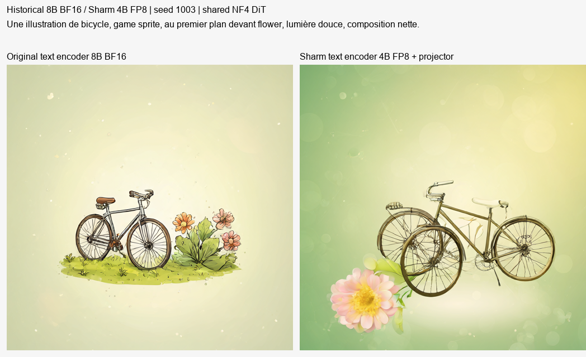

# Ancien test des encodeurs 8B et 4B

Cette archive contient **4 paires, 8 images originales**. Il s’agit des images récupérées de l’ancienne publication Hugging Face ; aucune nouvelle génération ni aucun entraînement n’a été fait.

Seul l’encodeur de texte change : Qwen3-VL 8B BF16 contre Qwen3-VL 4B FP8 avec son projecteur. Le générateur partagé était en NF4. Ce petit test historique ne compare pas le DiT FP8 actuel et ne mesure pas la précision des positions.

[Réglages et provenance](base-validation.json) · [SHA et sources](sources.json).

